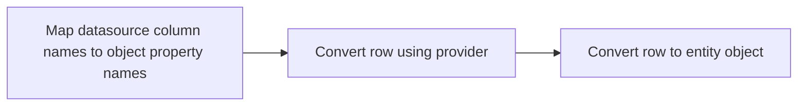

<!-- Generated from docs/. Edit the markdown in docs/ and run npm run docs:skill. -->

# The Mapping and Converting Pipelines

We will describe the primary mapping and converting pipelines used in Datasource below. These include:

- [The ReadonlyRepository read mapper and converting pipeline](#the-readonlyrepository-read-mapper-and-converting-pipeline)
- The statement mapping and converting pipeline (TODO)
- The SelectedIdMapping pipeline (TODO)

Words are great to describe these steps, but showing an example is worth more than a thousand words.

## The ReadonlyRepository read mapper and converting pipeline

This is the primary pipeline that maps and converts datasource rows to the entities used in the domain layer. We stop short of [object enrichment](enrichment.md) and leave that for another discussion.



### Map datasource column names to object property names

The reader returns raw rows (key/value pairs) which are renamed to the object property names using the mapper.

### Convert row using provider

`RowConverter` / `rowConverter` / `row_converter` converts the renamed row from provider cell types to object cell types. The keys stay the same. A SQLite bool stored as `1` or `0` becomes `true` or `false`. Uuid and datetime text become guid and datetime values where the dialect supports them.

Since the datasource type often can be mapped to multiple object types (string for example) the column type from the entity object must also be passed in.

### Convert row to entity object

`ObjectConverter` / `objectConverter` / `object_converter` assigns that row onto the entity. See [Metadata Row Type Converter](type-converters.md). You can also assign each property by hand.

> **TypeScript**
>
> The result is a `User` instance.

> **C#**
>
> The result is a `User`.

> **Rust**
>
> The result stays a `Row` and keeps the schema columns.

### Example

One walkthrough: seed users, read the raw rows, rename columns, convert cell types, then build entities with `MetaDataRowTypeConverter` / `MetaDataRowTypeConverter` / `MetaDataRowTypeConverter` or a manual map.

#### C# [⟨/⟩](https://github.com/deterministic-code/datasources/blob/main/csharp/Providers/Sqlite.Tests/ReadPipelineIntegrationTests.cs#L17-L24) [⟨/⟩](https://github.com/deterministic-code/datasources/blob/main/csharp/Providers/Sqlite.Tests/ReadPipelineIntegrationTests.cs#L26-L123)

```csharp
public class User
{
    public long Id { get; set; }
    public Guid Uuid { get; set; }
    public string Username { get; set; } = "";
    public bool IsEnabled { get; set; }
    public DateTime Created { get; set; }
}

var ada = Guid.Parse("11111111-1111-1111-1111-111111111111");
var grace = Guid.Parse("22222222-2222-2222-2222-222222222222");
var lin = Guid.Parse("33333333-3333-3333-3333-333333333333");
var ds = Datasource.Default;
var command = await ds.CreateCommand();
await command.Execute(
    "INSERT INTO users (id, uuid, name, is_enabled, created) VALUES ($id, $uuid, $name, $is_enabled, $created)",
    [
        new Parameter("id", 1),
        new Parameter("uuid", ada.ToString()),
        new Parameter("name", "ada"),
        new Parameter("is_enabled", 1),
        new Parameter("created", "2001-01-01T00:00:00.000Z"),
    ]);
await command.Execute(
    "INSERT INTO users (id, uuid, name, is_enabled, created) VALUES ($id, $uuid, $name, $is_enabled, $created)",
    [
        new Parameter("id", 2),
        new Parameter("uuid", grace.ToString()),
        new Parameter("name", "grace"),
        new Parameter("is_enabled", 1),
        new Parameter("created", "2002-02-02T00:00:00.000Z"),
    ]);
await command.Execute(
    "INSERT INTO users (id, uuid, name, is_enabled, created) VALUES ($id, $uuid, $name, $is_enabled, $created)",
    [
        new Parameter("id", 3),
        new Parameter("uuid", lin.ToString()),
        new Parameter("name", "lin"),
        new Parameter("is_enabled", 0),
        new Parameter("created", "2003-03-03T00:00:00.000Z"),
    ]);

var propertyToColumnMapper = new DictionaryMapper<string>(new Dictionary<string, string>
{
    ["Id"] = "id",
    ["Uuid"] = "uuid",
    ["Username"] = "name",
    ["IsEnabled"] = "is_enabled",
    ["Created"] = "created",
});

await using var reader = await command.ExecuteReader(
    "SELECT id, uuid, name, is_enabled, created FROM users");
var unmapped = await reader.Read().ToListAsync();

var columnMappedRows = unmapped
    .Select(row => new Row(row.Select(cell =>
        KeyValuePair.Create(propertyToColumnMapper.ReverseMap(cell.Key), cell.Value))))
    .ToList();

var rowConverter = RowTypeConverter.From(new SqliteDriver().RowTypeConverters, new Dictionary<string, string>
{
    ["Uuid"] = "uuid",
    ["IsEnabled"] = "bool",
    ["Created"] = "datetime",
});
var convertedRows = columnMappedRows.Select(rowConverter.Convert).ToList();

var objectConverter = new MetaDataRowTypeConverter<User>();
var finalEntities = convertedRows.Select(objectConverter.Convert).ToList();

var finalManualEntities = convertedRows.Select(row => new User
{
    Id = (long)row["Id"].ToObject()!,
    Uuid = (Guid)row["Uuid"].ToObject()!,
    Username = (string)row["Username"].ToObject()!,
    IsEnabled = (bool)row["IsEnabled"].ToObject()!,
    Created = (DateTime)row["Created"].ToObject()!,
}).ToList();
```

**Unmapped**

```
[
  { id: 1, uuid: '11111111-1111-1111-1111-111111111111', name: 'ada', is_enabled: 1, created: '2001-01-01T00:00:00.000Z' },
  { id: 2, uuid: '22222222-2222-2222-2222-222222222222', name: 'grace', is_enabled: 1, created: '2002-02-02T00:00:00.000Z' },
  { id: 3, uuid: '33333333-3333-3333-3333-333333333333', name: 'lin', is_enabled: 0, created: '2003-03-03T00:00:00.000Z' }
]
```

**Column mapped**

```
[
  { Id: 1, Uuid: '11111111-1111-1111-1111-111111111111', Username: 'ada', IsEnabled: 1, Created: '2001-01-01T00:00:00.000Z' },
  { Id: 2, Uuid: '22222222-2222-2222-2222-222222222222', Username: 'grace', IsEnabled: 1, Created: '2002-02-02T00:00:00.000Z' },
  { Id: 3, Uuid: '33333333-3333-3333-3333-333333333333', Username: 'lin', IsEnabled: 0, Created: '2003-03-03T00:00:00.000Z' }
]
```

**Type converted**

```
[
  { Id: 1, Uuid: Guid('11111111-1111-1111-1111-111111111111'), Username: 'ada', IsEnabled: true, Created: '2001-01-01T00:00:00.000Z' },
  { Id: 2, Uuid: Guid('22222222-2222-2222-2222-222222222222'), Username: 'grace', IsEnabled: true, Created: '2002-02-02T00:00:00.000Z' },
  { Id: 3, Uuid: Guid('33333333-3333-3333-3333-333333333333'), Username: 'lin', IsEnabled: false, Created: '2003-03-03T00:00:00.000Z' }
]
```

**Entities**

```
[
  { Id: 1, Uuid: Guid('11111111-1111-1111-1111-111111111111'), Username: 'ada', IsEnabled: true, Created: '2001-01-01T00:00:00.000Z' },
  { Id: 2, Uuid: Guid('22222222-2222-2222-2222-222222222222'), Username: 'grace', IsEnabled: true, Created: '2002-02-02T00:00:00.000Z' },
  { Id: 3, Uuid: Guid('33333333-3333-3333-3333-333333333333'), Username: 'lin', IsEnabled: false, Created: '2003-03-03T00:00:00.000Z' }
]
```

**Manual entities**

```
[
  { Id: 1, Uuid: Guid('11111111-1111-1111-1111-111111111111'), Username: 'ada', IsEnabled: true, Created: '2001-01-01T00:00:00.000Z' },
  { Id: 2, Uuid: Guid('22222222-2222-2222-2222-222222222222'), Username: 'grace', IsEnabled: true, Created: '2002-02-02T00:00:00.000Z' },
  { Id: 3, Uuid: Guid('33333333-3333-3333-3333-333333333333'), Username: 'lin', IsEnabled: false, Created: '2003-03-03T00:00:00.000Z' }
]
```

#### Rust [⟨/⟩](https://github.com/deterministic-code/datasources/blob/main/rust/providers/sqlite/tests/read_pipeline.rs#L12-L22) [⟨/⟩](https://github.com/deterministic-code/datasources/blob/main/rust/providers/sqlite/tests/read_pipeline.rs#L24-L160)

```rust
impl ConvertSchema for User {
    fn schema() -> Vec<(&'static str, &'static str)> {
        vec![
            ("Id", "INTEGER"),
            ("Uuid", "TEXT"),
            ("Username", "TEXT"),
            ("IsEnabled", "INTEGER"),
            ("Created", "TEXT"),
        ]
    }
}

let ada = Uuid::parse_str("11111111-1111-1111-1111-111111111111").unwrap();
let grace = Uuid::parse_str("22222222-2222-2222-2222-222222222222").unwrap();
let lin = Uuid::parse_str("33333333-3333-3333-3333-333333333333").unwrap();

let ds = default().unwrap();
let command = ds.create_command(None).await.unwrap();
command
    .execute(
        "INSERT INTO users (id, uuid, name, is_enabled, created) VALUES ($id, $uuid, $name, $is_enabled, $created)",
        Some(&[
            Parameter::new("id", 1_i64),
            Parameter::new("uuid", ada.to_string()),
            Parameter::new("name", "ada"),
            Parameter::new("is_enabled", 1_i64),
            Parameter::new("created", "2001-01-01T00:00:00.000Z"),
        ]),
    )
    .await
    .unwrap();
command
    .execute(
        "INSERT INTO users (id, uuid, name, is_enabled, created) VALUES ($id, $uuid, $name, $is_enabled, $created)",
        Some(&[
            Parameter::new("id", 2_i64),
            Parameter::new("uuid", grace.to_string()),
            Parameter::new("name", "grace"),
            Parameter::new("is_enabled", 1_i64),
            Parameter::new("created", "2002-02-02T00:00:00.000Z"),
        ]),
    )
    .await
    .unwrap();
command
    .execute(
        "INSERT INTO users (id, uuid, name, is_enabled, created) VALUES ($id, $uuid, $name, $is_enabled, $created)",
        Some(&[
            Parameter::new("id", 3_i64),
            Parameter::new("uuid", lin.to_string()),
            Parameter::new("name", "lin"),
            Parameter::new("is_enabled", 0_i64),
            Parameter::new("created", "2003-03-03T00:00:00.000Z"),
        ]),
    )
    .await
    .unwrap();

let property_to_column_mapper = DictionaryMapper::new([
    ("Id".into(), "id".into()),
    ("Uuid".into(), "uuid".into()),
    ("Username".into(), "name".into()),
    ("IsEnabled".into(), "is_enabled".into()),
    ("Created".into(), "created".into()),
]);

let reader = command
    .execute_reader("SELECT id, uuid, name, is_enabled, created FROM users", None)
    .await
    .unwrap();
let unmapped: Vec<Row> = reader.read().try_collect().await.unwrap();

let column_mapped_rows: Vec<Row> = unmapped
    .iter()
    .map(|row| {
        row.iter()
            .map(|(key, value)| {
                (
                    Mapper::reverse_map(&property_to_column_mapper, key.clone()),
                    value.clone(),
                )
            })
            .collect()
    })
    .collect();

let columns = HashMap::from([
    ("Uuid".into(), "uuid".into()),
    ("IsEnabled".into(), "bool".into()),
    ("Created".into(), "datetime".into()),
]);
let row_converter = RowTypeConverter::from(|| crate::SqliteDriver.row_type_converters(), &columns);
let converted_rows: Vec<Row> = column_mapped_rows
    .iter()
    .map(|row| row_converter.convert(row).unwrap())
    .collect();

let object_converter = MetaDataRowTypeConverter::of::<User>();
let final_entities: Vec<Row> = converted_rows
    .iter()
    .map(|row| object_converter.convert(row).unwrap())
    .collect();
```

**Unmapped**

```
[
  { id: 1, uuid: '11111111-1111-1111-1111-111111111111', name: 'ada', is_enabled: 1, created: '2001-01-01T00:00:00.000Z' },
  { id: 2, uuid: '22222222-2222-2222-2222-222222222222', name: 'grace', is_enabled: 1, created: '2002-02-02T00:00:00.000Z' },
  { id: 3, uuid: '33333333-3333-3333-3333-333333333333', name: 'lin', is_enabled: 0, created: '2003-03-03T00:00:00.000Z' }
]
```

**Column mapped**

```
[
  { Id: 1, Uuid: '11111111-1111-1111-1111-111111111111', Username: 'ada', IsEnabled: 1, Created: '2001-01-01T00:00:00.000Z' },
  { Id: 2, Uuid: '22222222-2222-2222-2222-222222222222', Username: 'grace', IsEnabled: 1, Created: '2002-02-02T00:00:00.000Z' },
  { Id: 3, Uuid: '33333333-3333-3333-3333-333333333333', Username: 'lin', IsEnabled: 0, Created: '2003-03-03T00:00:00.000Z' }
]
```

**Type converted**

```
[
  { Id: 1, Uuid: Uuid('11111111-1111-1111-1111-111111111111'), Username: 'ada', IsEnabled: true, Created: '2001-01-01T00:00:00.000Z' },
  { Id: 2, Uuid: Uuid('22222222-2222-2222-2222-222222222222'), Username: 'grace', IsEnabled: true, Created: '2002-02-02T00:00:00.000Z' },
  { Id: 3, Uuid: Uuid('33333333-3333-3333-3333-333333333333'), Username: 'lin', IsEnabled: false, Created: '2003-03-03T00:00:00.000Z' }
]
```

**Entities**

```
[
  { Id: 1, Uuid: Uuid('11111111-1111-1111-1111-111111111111'), Username: 'ada', IsEnabled: true, Created: '2001-01-01T00:00:00.000Z' },
  { Id: 2, Uuid: Uuid('22222222-2222-2222-2222-222222222222'), Username: 'grace', IsEnabled: true, Created: '2002-02-02T00:00:00.000Z' },
  { Id: 3, Uuid: Uuid('33333333-3333-3333-3333-333333333333'), Username: 'lin', IsEnabled: false, Created: '2003-03-03T00:00:00.000Z' }
]
```

#### TypeScript [⟨/⟩](https://github.com/deterministic-code/datasources/blob/main/typescript/providers/sqlite/tests/read-pipeline.integration.test.ts#L12-L18) [⟨/⟩](https://github.com/deterministic-code/datasources/blob/main/typescript/providers/sqlite/tests/read-pipeline.integration.test.ts#L29-L122)

```typescript
class User {
  Id = 0;
  Uuid = "";
  Username = "";
  IsEnabled = false;
  Created = new Date(0);
}

const ada = "11111111-1111-1111-1111-111111111111";
const grace = "22222222-2222-2222-2222-222222222222";
const lin = "33333333-3333-3333-3333-333333333333";
const ds = Datasource.default;
const command = await ds.createCommand();
await command.execute(
  "INSERT INTO users (id, uuid, name, is_enabled, created) VALUES ($id, $uuid, $name, $is_enabled, $created)",
  [
    { name: "id", value: 1 },
    { name: "uuid", value: ada },
    { name: "name", value: "ada" },
    { name: "is_enabled", value: 1 },
    { name: "created", value: "2001-01-01T00:00:00.000Z" },
  ],
);
await command.execute(
  "INSERT INTO users (id, uuid, name, is_enabled, created) VALUES ($id, $uuid, $name, $is_enabled, $created)",
  [
    { name: "id", value: 2 },
    { name: "uuid", value: grace },
    { name: "name", value: "grace" },
    { name: "is_enabled", value: 1 },
    { name: "created", value: "2002-02-02T00:00:00.000Z" },
  ],
);
await command.execute(
  "INSERT INTO users (id, uuid, name, is_enabled, created) VALUES ($id, $uuid, $name, $is_enabled, $created)",
  [
    { name: "id", value: 3 },
    { name: "uuid", value: lin },
    { name: "name", value: "lin" },
    { name: "is_enabled", value: 0 },
    { name: "created", value: "2003-03-03T00:00:00.000Z" },
  ],
);

const propertyToColumnMapper = new DictionaryMapper([
  ["Id", "id"],
  ["Uuid", "uuid"],
  ["Username", "name"],
  ["IsEnabled", "is_enabled"],
  ["Created", "created"],
]);

await using reader = await command.executeReader(
  "SELECT id, uuid, name, is_enabled, created FROM users",
);
const unmapped = await Array.fromAsync(reader.read());

const columnMappedRows = unmapped.map((row) =>
  Object.fromEntries(
    Object.entries(row).map(([key, value]) => [propertyToColumnMapper.reverseMap(key), value]),
  ),
);

const rowConverter = RowTypeConverter.from(new SqliteDriver().rowTypeConverters, {
  Uuid: "uuid",
  IsEnabled: "bool",
  Created: "datetime",
});
const convertedRows = columnMappedRows.map((row) => rowConverter.convert(row));

const objectConverter = new MetaDataRowTypeConverter<User>();
const finalEntities = convertedRows.map((row) => objectConverter.convert(row, User));

const finalManualEntities = convertedRows.map(
  (row) =>
    Object.assign(new User(), {
      Id: row.Id,
      Uuid: row.Uuid,
      Username: row.Username,
      IsEnabled: row.IsEnabled,
      Created: row.Created,
    }),
);

expect(unmapped).toHaveLength(3);
expect(unmapped[0]).toMatchObject({ id: 1, uuid: ada, name: "ada" });
expect(columnMappedRows[0]).toMatchObject({ Id: 1, Uuid: ada, Username: "ada" });
```

**Unmapped**

```
[
  { id: 1, uuid: '11111111-1111-1111-1111-111111111111', name: 'ada', is_enabled: 1, created: '2001-01-01T00:00:00.000Z' },
  { id: 2, uuid: '22222222-2222-2222-2222-222222222222', name: 'grace', is_enabled: 1, created: '2002-02-02T00:00:00.000Z' },
  { id: 3, uuid: '33333333-3333-3333-3333-333333333333', name: 'lin', is_enabled: 0, created: '2003-03-03T00:00:00.000Z' }
]
```

**Column mapped**

```
[
  { Id: 1, Uuid: '11111111-1111-1111-1111-111111111111', Username: 'ada', IsEnabled: 1, Created: '2001-01-01T00:00:00.000Z' },
  { Id: 2, Uuid: '22222222-2222-2222-2222-222222222222', Username: 'grace', IsEnabled: 1, Created: '2002-02-02T00:00:00.000Z' },
  { Id: 3, Uuid: '33333333-3333-3333-3333-333333333333', Username: 'lin', IsEnabled: 0, Created: '2003-03-03T00:00:00.000Z' }
]
```

**Type converted**

```
[
  { Id: 1, Uuid: '11111111-1111-1111-1111-111111111111', Username: 'ada', IsEnabled: true, Created: '2001-01-01T00:00:00.000Z' },
  { Id: 2, Uuid: '22222222-2222-2222-2222-222222222222', Username: 'grace', IsEnabled: true, Created: '2002-02-02T00:00:00.000Z' },
  { Id: 3, Uuid: '33333333-3333-3333-3333-333333333333', Username: 'lin', IsEnabled: false, Created: '2003-03-03T00:00:00.000Z' }
]
```

**Entities**

```
[
  { Id: 1, Uuid: '11111111-1111-1111-1111-111111111111', Username: 'ada', IsEnabled: true, Created: '2001-01-01T00:00:00.000Z' },
  { Id: 2, Uuid: '22222222-2222-2222-2222-222222222222', Username: 'grace', IsEnabled: true, Created: '2002-02-02T00:00:00.000Z' },
  { Id: 3, Uuid: '33333333-3333-3333-3333-333333333333', Username: 'lin', IsEnabled: false, Created: '2003-03-03T00:00:00.000Z' }
]
```

**Manual entities**

```
[
  { Id: 1, Uuid: '11111111-1111-1111-1111-111111111111', Username: 'ada', IsEnabled: true, Created: '2001-01-01T00:00:00.000Z' },
  { Id: 2, Uuid: '22222222-2222-2222-2222-222222222222', Username: 'grace', IsEnabled: true, Created: '2002-02-02T00:00:00.000Z' },
  { Id: 3, Uuid: '33333333-3333-3333-3333-333333333333', Username: 'lin', IsEnabled: false, Created: '2003-03-03T00:00:00.000Z' }
]
```

Schema: [pipeline-users](docs/examples.md#pipeline-users)

```sql
CREATE TABLE users (id int, uuid uuid NOT NULL, name string NOT NULL, is_enabled bool NOT NULL, created datetime NOT NULL, CONSTRAINT pk_users PRIMARY KEY (id))
```

## Mappers

Bidirectional `Map` / `map` / `map` and `ReverseMap` / `reverseMap` / `reverse_map`. Column names pass through unless a mapper rewrites them. Repository read is convert, then map.

### Classes

##### TypeScript

##### IMapper {#typescript-imapper}

```typescript
interface IMapper<TFrom, TTo>
```

**Methods**

| Name | Description |
| --- | --- |
| [map(value)](#typescript-imapper-map-value) | Maps `TFrom` to `TTo`. |
| [reverseMap(value)](#typescript-imapper-reversemap-value) | Maps `TTo` back to `TFrom`. |

###### map(value) {#typescript-imapper-map-value}

Maps `TFrom` to `TTo`.

**Definition**

```typescript
map(value: TFrom): TTo
```

**Parameters**

| Name | Description |
| --- | --- |
| `value` | source value |

**Returns**

`TTo`

###### reverseMap(value) {#typescript-imapper-reversemap-value}

Maps `TTo` back to `TFrom`.

**Definition**

```typescript
reverseMap(value: TTo): TFrom
```

**Parameters**

| Name | Description |
| --- | --- |
| `value` | mapped value |

**Returns**

`TFrom`

##### C#

##### IMapper {#csharp-imapper}

```csharp
public interface IMapper<TFrom, TTo>
```

**Methods**

| Name | Description |
| --- | --- |
| [Map(value)](#csharp-imapper-map-value) | Maps `TFrom` to `TTo`. |
| [ReverseMap(value)](#csharp-imapper-reversemap-value) | Maps `TTo` back to `TFrom`. |

###### Map(value) {#csharp-imapper-map-value}

Maps `TFrom` to `TTo`.

**Definition**

```csharp
TTo Map(TFrom value)
```

**Parameters**

| Name | Description |
| --- | --- |
| `value` | source value |

**Returns**

`TTo`

###### ReverseMap(value) {#csharp-imapper-reversemap-value}

Maps `TTo` back to `TFrom`.

**Definition**

```csharp
TFrom ReverseMap(TTo value)
```

**Parameters**

| Name | Description |
| --- | --- |
| `value` | mapped value |

**Returns**

`TFrom`

##### Rust

##### Mapper {#rust-mapper}

```rust
pub trait Mapper<TFrom, TTo>
```

**Methods**

| Name | Description |
| --- | --- |
| [map(value)](#rust-mapper-map-value) | Maps `TFrom` to `TTo`. |
| [reverse_map(value)](#rust-mapper-reverse_map-value) | Maps `TTo` back to `TFrom`. |

###### map(value) {#rust-mapper-map-value}

Maps `TFrom` to `TTo`.

**Definition**

```rust
fn map(&self, value: TFrom) -> TTo
```

**Parameters**

| Name | Description |
| --- | --- |
| `value` | source value |

**Returns**

`TTo`

###### reverse_map(value) {#rust-mapper-reverse_map-value}

Maps `TTo` back to `TFrom`.

**Definition**

```rust
fn reverse_map(&self, value: TTo) -> TFrom
```

**Parameters**

| Name | Description |
| --- | --- |
| `value` | mapped value |

**Returns**

`TFrom`

### Examples

#### Transform a contact

##### C# [⟨/⟩](https://github.com/deterministic-code/datasources/blob/main/csharp/Datasources.Tests/TransformMapperTests.cs#L41-L52)

```csharp
var contact = new Contact("Ada", "ada@x.dev");
var mapper = new TransformMapper<Contact, ContactRow>(
    map: item => new ContactRow(item.Name, item.Email),
    reverseMap: row => new Contact(row.ContactName, row.ContactEmail));
var mapped = mapper.Map(contact);
var reversed = mapper.ReverseMap(mapped);
```

**Before: contact**

```
{
  name: 'Ada',
  email: 'ada@x.dev'
}
```

**After: mapped contact**

```
{
  contactName: 'Ada',
  contactEmail: 'ada@x.dev'
}
```

##### Rust [⟨/⟩](https://github.com/deterministic-code/datasources/blob/main/rust/datasources/src/mappers/mod.rs#L146-L172)

```rust
let contact = Contact {
    name: "Ada".into(),
    email: "ada@x.dev".into(),
};
let mapper = TransformMapper::new(
    |item: Contact| ContactRow {
        contact_name: item.name,
        contact_email: item.email,
    },
    |row: ContactRow| Contact {
        name: row.contact_name,
        email: row.contact_email,
    },
);
let mapped = Mapper::map(&mapper, contact.clone());
let reversed = Mapper::reverse_map(&mapper, mapped.clone());
```

**Before: contact**

```
{
  name: 'Ada',
  email: 'ada@x.dev'
}
```

**After: mapped contact**

```
{
  contactName: 'Ada',
  contactEmail: 'ada@x.dev'
}
```

##### TypeScript [⟨/⟩](https://github.com/deterministic-code/datasources/blob/main/typescript/datasources/src/mappers/transformMapper.test.ts#L55-L65)

```typescript
const contact: Contact = { name: "Ada", email: "ada@x.dev" };
const mapper = new TransformMapper<Contact, ContactRow>(
  (item) => ({ contactName: item.name, contactEmail: item.email }),
  (row) => ({ name: row.contactName, email: row.contactEmail }),
);
const mapped = mapper.map(contact);
const reversed = mapper.reverseMap(mapped);
```

**Before: contact**

```
{
  name: 'Ada',
  email: 'ada@x.dev'
}
```

**After: mapped contact**

```
{
  contactName: 'Ada',
  contactEmail: 'ada@x.dev'
}
```

#### Change casing

##### C# [⟨/⟩](https://github.com/deterministic-code/datasources/blob/main/csharp/Datasources.Tests/ChangeCasingMapperTests.cs#L17-L27)

```csharp
var mapper = new ChangeCasingMapper(Casing.Pascal, Casing.Snake);
var contact = mapper.Map("Contact");
var firstName = mapper.Map("FirstName");
var emailAddress = mapper.Map("EmailAddress");
```

**Map**

```
contact
first_name
email_address
```

##### Rust [⟨/⟩](https://github.com/deterministic-code/datasources/blob/main/rust/datasources/src/mappers/change_casing_mapper.rs#L43-L52)

```rust
let mapper = ChangeCasingMapper::new(Casing::Pascal, Casing::Snake);
let contact = mapper.map("Contact".into());
let first_name = mapper.map("FirstName".into());
let email_address = mapper.map("EmailAddress".into());
```

**Map**

```
contact
first_name
email_address
```

##### TypeScript [⟨/⟩](https://github.com/deterministic-code/datasources/blob/main/typescript/datasources/src/mappers/ChangeCasingMapper.test.ts#L13-L21)

```typescript
const mapper = new ChangeCasingMapper("pascalCase", "snakeCase");
const contact = mapper.map("Contact");
const firstName = mapper.map("FirstName");
const emailAddress = mapper.map("EmailAddress");
```

**Map**

```
contact
first_name
email_address
```

##### C# [⟨/⟩](https://github.com/deterministic-code/datasources/blob/main/csharp/Datasources.Tests/ChangeCasingMapperTests.cs#L29-L39)

```csharp
var mapper = new ChangeCasingMapper(Casing.Pascal, Casing.Snake);
var contact = mapper.ReverseMap("contact");
var firstName = mapper.ReverseMap("first_name");
var emailAddress = mapper.ReverseMap("email_address");
```

**Reverse map**

```
Contact
FirstName
EmailAddress
```

##### Rust [⟨/⟩](https://github.com/deterministic-code/datasources/blob/main/rust/datasources/src/mappers/change_casing_mapper.rs#L54-L63)

```rust
let mapper = ChangeCasingMapper::new(Casing::Pascal, Casing::Snake);
let contact = mapper.reverse_map("contact".into());
let first_name = mapper.reverse_map("first_name".into());
let email_address = mapper.reverse_map("email_address".into());
```

**Reverse map**

```
Contact
FirstName
EmailAddress
```

##### TypeScript [⟨/⟩](https://github.com/deterministic-code/datasources/blob/main/typescript/datasources/src/mappers/ChangeCasingMapper.test.ts#L23-L31)

```typescript
const mapper = new ChangeCasingMapper("pascalCase", "snakeCase");
const contact = mapper.reverseMap("contact");
const firstName = mapper.reverseMap("first_name");
const emailAddress = mapper.reverseMap("email_address");
```

**Reverse map**

```
Contact
FirstName
EmailAddress
```

#### Lowercase plural

##### C# [⟨/⟩](https://github.com/deterministic-code/datasources/blob/main/csharp/Datasources.Tests/PluralizerMapperTests.cs#L35-L48)

```csharp
var casing = new ChangeCasingMapper(Casing.Pascal, Casing.Snake);
var pluralizer = new PluralizerMapper();
var contact = pluralizer.Map(casing.Map("Contact"));
var address = pluralizer.Map(casing.Map("Address"));
var contactName = casing.ReverseMap(pluralizer.ReverseMap(contact));
var addressName = casing.ReverseMap(pluralizer.ReverseMap(address));
```

**Map**

```
contacts
addresses
```

**Reverse map**

```
Contact
Address
```

##### Rust [⟨/⟩](https://github.com/deterministic-code/datasources/blob/main/rust/datasources/src/mappers/pluralizer_mapper.rs#L63-L75)

```rust
let casing = ChangeCasingMapper::new(Casing::Pascal, Casing::Snake);
let pluralizer = PluralizerMapper::new();
let contact = pluralizer.map(casing.map("Contact".into()));
let address = pluralizer.map(casing.map("Address".into()));
let contact_name = casing.reverse_map(pluralizer.reverse_map(contact.clone()));
let address_name = casing.reverse_map(pluralizer.reverse_map(address.clone()));
```

**Map**

```
contacts
addresses
```

**Reverse map**

```
Contact
Address
```

##### TypeScript [⟨/⟩](https://github.com/deterministic-code/datasources/blob/main/typescript/datasources/src/mappers/PluralizerMapper.test.ts#L28-L39)

```typescript
const casing = new ChangeCasingMapper("pascalCase", "snakeCase");
const pluralizer = new PluralizerMapper();
const contact = pluralizer.map(casing.map("Contact"));
const address = pluralizer.map(casing.map("Address"));
const contactName = casing.reverseMap(pluralizer.reverseMap(contact));
const addressName = casing.reverseMap(pluralizer.reverseMap(address));
```

**Map**

```
contacts
addresses
```

**Reverse map**

```
Contact
Address
```

#### Flat to nested

##### C# [⟨/⟩](https://github.com/deterministic-code/datasources/blob/main/csharp/Datasources.Tests/FlatToNestedMapperTests.cs#L101-L164)

```csharp
var mapper = new FlatToNestedMapper(new TypeMap
{
    Key = "id",
    Fields = new Dictionary<string, TypeMapField>
    {
        ["id"] = "id",
        ["first_name"] = "first_name",
        ["last_name"] = "last_name",
        ["email"] = "email",
        ["contact_source_name"] = "contact_source_name",
        ["contact_type_name"] = "contact_type_name",
        ["addresses"] = new TypeMapGroup
        {
            Key = "address_id",
            Fields = new Dictionary<string, TypeMapField>
            {
                ["id"] = "address_id",
                ["line1"] = "address_line1",
                ["city"] = "address_city",
                ["address_type_name"] = "address_type_name",
            },
        },
        ["phones"] = new TypeMapGroup
        {
            Key = "phone_id",
            Fields = new Dictionary<string, TypeMapField>
            {
                ["id"] = "phone_id",
                ["number"] = "phone_number",
                ["phone_type_name"] = "phone_type_name",
            },
        },
    },
});
var adaHome = new Row(
[
    new("id", 7),
    new("first_name", "Ada"),
    new("last_name", "Lovelace"),
    new("email", "ada@ex.com"),
    new("contact_source_name", "Web"),
    new("contact_type_name", "Person"),
    new("address_id", 101),
    new("address_line1", "10 Downing St"),
    new("address_city", "London"),
    new("address_type_name", "Home"),
    new("phone_id", 201),
    new("phone_number", "+44"),
    new("phone_type_name", "Mobile"),
]);
var adaWork = new Row(adaHome)
{
    ["address_id"] = 102,
    ["address_line1"] = "1 Parliament Sq"
};
var nested = mapper.Map([adaHome, adaWork]);
var flat = mapper.ReverseMap(nested);
```

**After: nested contact**

```
{
  id: 7,
  first_name: "Ada",
  last_name: "Lovelace",
  email: "ada@ex.com",
  contact_source_name: "Web",
  contact_type_name: "Person",
  addresses: [
    { id: 101, line1: "10 Downing St", city: "London", address_type_name: "Home" },
    { id: 102, line1: "1 Parliament Sq", city: "London", address_type_name: "Home" }
  ],
  phones: [{ id: 201, number: "+44", phone_type_name: "Mobile" }]
}
```

**After: reverseMap join rows**

```
[
  {
    id: 7,
    first_name: "Ada",
    last_name: "Lovelace",
    email: "ada@ex.com",
    contact_source_name: "Web",
    contact_type_name: "Person",
    address_id: 101,
    address_line1: "10 Downing St",
    address_city: "London",
    address_type_name: "Home",
    phone_id: 201,
    phone_number: "+44",
    phone_type_name: "Mobile"
  },
  {
    id: 7,
    first_name: "Ada",
    last_name: "Lovelace",
    email: "ada@ex.com",
    contact_source_name: "Web",
    contact_type_name: "Person",
    address_id: 102,
    address_line1: "1 Parliament Sq",
    address_city: "London",
    address_type_name: "Home",
    phone_id: 201,
    phone_number: "+44",
    phone_type_name: "Mobile"
  }
]
```

##### Rust [⟨/⟩](https://github.com/deterministic-code/datasources/blob/main/rust/datasources/src/mappers/flat_to_nested_mapper.rs#L385-L456)

```rust
let mapper = FlatToNestedMapper::new(TypeMap::new(
    "id",
    vec![
        ("id".into(), TypeMapField::column("id")),
        ("first_name".into(), TypeMapField::column("first_name")),
        ("last_name".into(), TypeMapField::column("last_name")),
        ("email".into(), TypeMapField::column("email")),
        (
            "contact_source_name".into(),
            TypeMapField::column("contact_source_name"),
        ),
        (
            "contact_type_name".into(),
            TypeMapField::column("contact_type_name"),
        ),
        (
            "addresses".into(),
            TypeMapField::Group(TypeMapGroup::new(
                "address_id",
                vec![
                    ("id".into(), TypeMapField::column("address_id")),
                    ("line1".into(), TypeMapField::column("address_line1")),
                    ("city".into(), TypeMapField::column("address_city")),
                    (
                        "address_type_name".into(),
                        TypeMapField::column("address_type_name"),
                    ),
                ],
            )),
        ),
        (
            "phones".into(),
            TypeMapField::Group(TypeMapGroup::new(
                "phone_id",
                vec![
                    ("id".into(), TypeMapField::column("phone_id")),
                    ("number".into(), TypeMapField::column("phone_number")),
                    (
                        "phone_type_name".into(),
                        TypeMapField::column("phone_type_name"),
                    ),
                ],
            )),
        ),
    ],
));
let ada_home = cell(&[
    ("id", Value::Int(7)),
    ("first_name", Value::from("Ada")),
    ("last_name", Value::from("Lovelace")),
    ("email", Value::from("ada@ex.com")),
    ("contact_source_name", Value::from("Web")),
    ("contact_type_name", Value::from("Person")),
    ("address_id", Value::Int(101)),
    ("address_line1", Value::from("10 Downing St")),
    ("address_city", Value::from("London")),
    ("address_type_name", Value::from("Home")),
    ("phone_id", Value::Int(201)),
    ("phone_number", Value::from("+44")),
    ("phone_type_name", Value::from("Mobile")),
]);
let mut ada_work = ada_home.clone();
ada_work.insert("address_id".into(), Value::Int(102));
ada_work.insert("address_line1".into(), Value::from("1 Parliament Sq"));
let nested = Mapper::map(&mapper, vec![ada_home.clone(), ada_work.clone()]);
let flat = Mapper::reverse_map(&mapper, nested.clone());
```

**After: nested contact**

```
{
  id: 7,
  first_name: "Ada",
  last_name: "Lovelace",
  email: "ada@ex.com",
  contact_source_name: "Web",
  contact_type_name: "Person",
  addresses: [
    { id: 101, line1: "10 Downing St", city: "London", address_type_name: "Home" },
    { id: 102, line1: "1 Parliament Sq", city: "London", address_type_name: "Home" }
  ],
  phones: [{ id: 201, number: "+44", phone_type_name: "Mobile" }]
}
```

**After: reverseMap join rows**

```
[
  {
    id: 7,
    first_name: "Ada",
    last_name: "Lovelace",
    email: "ada@ex.com",
    contact_source_name: "Web",
    contact_type_name: "Person",
    address_id: 101,
    address_line1: "10 Downing St",
    address_city: "London",
    address_type_name: "Home",
    phone_id: 201,
    phone_number: "+44",
    phone_type_name: "Mobile"
  },
  {
    id: 7,
    first_name: "Ada",
    last_name: "Lovelace",
    email: "ada@ex.com",
    contact_source_name: "Web",
    contact_type_name: "Person",
    address_id: 102,
    address_line1: "1 Parliament Sq",
    address_city: "London",
    address_type_name: "Home",
    phone_id: 201,
    phone_number: "+44",
    phone_type_name: "Mobile"
  }
]
```

##### TypeScript [⟨/⟩](https://github.com/deterministic-code/datasources/blob/main/typescript/datasources/src/mappers/FlatToNestedMapper.test.ts#L90-L155)

```typescript
const mapper = new FlatToNestedMapper<Contact>({
  key: "id",
  fields: {
    id: "id",
    first_name: "first_name",
    last_name: "last_name",
    email: "email",
    contact_source_name: "contact_source_name",
    contact_type_name: "contact_type_name",
    addresses: {
      key: "address_id",
      fields: {
        id: "address_id",
        line1: "address_line1",
        city: "address_city",
        address_type_name: "address_type_name",
      },
    },
    phones: {
      key: "phone_id",
      fields: {
        id: "phone_id",
        number: "phone_number",
        phone_type_name: "phone_type_name",
      },
    },
  },
});
const adaHome: Cells = {
  id: 7,
  first_name: "Ada",
  last_name: "Lovelace",
  email: "ada@ex.com",
  contact_source_name: "Web",
  contact_type_name: "Person",
  address_id: 101,
  address_line1: "10 Downing St",
  address_city: "London",
  address_type_name: "Home",
  phone_id: 201,
  phone_number: "+44",
  phone_type_name: "Mobile",
};
const adaWork = {
  ...adaHome,
  address_id: 102,
  address_line1: "1 Parliament Sq",
};
const nested = mapper.map([adaHome, adaWork]);
const flat = mapper.reverseMap(nested);
```

**After: nested contact**

```
{
  id: 7,
  first_name: "Ada",
  last_name: "Lovelace",
  email: "ada@ex.com",
  contact_source_name: "Web",
  contact_type_name: "Person",
  addresses: [
    { id: 101, line1: "10 Downing St", city: "London", address_type_name: "Home" },
    { id: 102, line1: "1 Parliament Sq", city: "London", address_type_name: "Home" }
  ],
  phones: [{ id: 201, number: "+44", phone_type_name: "Mobile" }]
}
```

**After: reverseMap join rows**

```
[
  {
    id: 7,
    first_name: "Ada",
    last_name: "Lovelace",
    email: "ada@ex.com",
    contact_source_name: "Web",
    contact_type_name: "Person",
    address_id: 101,
    address_line1: "10 Downing St",
    address_city: "London",
    address_type_name: "Home",
    phone_id: 201,
    phone_number: "+44",
    phone_type_name: "Mobile"
  },
  {
    id: 7,
    first_name: "Ada",
    last_name: "Lovelace",
    email: "ada@ex.com",
    contact_source_name: "Web",
    contact_type_name: "Person",
    address_id: 102,
    address_line1: "1 Parliament Sq",
    address_city: "London",
    address_type_name: "Home",
    phone_id: 201,
    phone_number: "+44",
    phone_type_name: "Mobile"
  }
]
```

### See also

- [IdentityMapper](#)
- [DictionaryMapper](#)
- [PluralizerMapper](#)
- [ChangeCasingMapper](#)
- [TransformMapper](#)
- [FlatToNestedMapper](#)
- [ReadonlyRepositoryMappingOptions](readonly-repository.md#readonlyrepositoryoptions)

## IdentityMapper

Mapper that returns the value unchanged.

### Classes

##### TypeScript

##### IdentityMapper {#typescript-identitymapper}

```typescript
class IdentityMapper<T> implements IMapper<T, T>
```

**Methods**

| Name | Description |
| --- | --- |
| [map(value)](#typescript-identitymapper-map-value) | Returns `value`. |
| [reverseMap(value)](#typescript-identitymapper-reversemap-value) | Returns `value`. |

###### map(value) {#typescript-identitymapper-map-value}

Returns `value`.

**Definition**

```typescript
map(value: T): T
```

**Parameters**

| Name | Description |
| --- | --- |
| `value` | source value |

**Returns**

`T`

###### reverseMap(value) {#typescript-identitymapper-reversemap-value}

Returns `value`.

**Definition**

```typescript
reverseMap(value: T): T
```

**Parameters**

| Name | Description |
| --- | --- |
| `value` | mapped value |

**Returns**

`T`

##### C#

##### IdentityMapper {#csharp-identitymapper}

```csharp
public class IdentityMapper<T> : IMapper<T, T>
```

**Methods**

| Name | Description |
| --- | --- |
| [Map(value)](#csharp-identitymapper-map-value) | Returns `value`. |
| [ReverseMap(value)](#csharp-identitymapper-reversemap-value) | Returns `value`. |

###### Map(value) {#csharp-identitymapper-map-value}

Returns `value`.

**Definition**

```csharp
T Map(T value)
```

**Parameters**

| Name | Description |
| --- | --- |
| `value` | source value |

**Returns**

`T`

###### ReverseMap(value) {#csharp-identitymapper-reversemap-value}

Returns `value`.

**Definition**

```csharp
T ReverseMap(T value)
```

**Parameters**

| Name | Description |
| --- | --- |
| `value` | mapped value |

**Returns**

`T`

##### Rust

##### IdentityMapper {#rust-identitymapper}

```rust
pub struct IdentityMapper<T>
```

**Constructor**

| Name | Description |
| --- | --- |
| [new()](#rust-identitymapper-new) | Builds an identity mapper. |

**Methods**

| Name | Description |
| --- | --- |
| [map(value)](#rust-identitymapper-map-value) | Returns `value`. |
| [reverse_map(value)](#rust-identitymapper-reverse_map-value) | Returns `value`. |

###### new() {#rust-identitymapper-new}

Builds an identity mapper.

**Definition**

```rust
pub fn new() -> Self
```

**Returns**

[IdentityMapper](#rust-identitymapper)

###### map(value) {#rust-identitymapper-map-value}

Returns `value`.

**Definition**

```rust
fn map(&self, value: T) -> T
```

**Parameters**

| Name | Description |
| --- | --- |
| `value` | source value |

**Returns**

`T`

###### reverse_map(value) {#rust-identitymapper-reverse_map-value}

Returns `value`.

**Definition**

```rust
fn reverse_map(&self, value: T) -> T
```

**Parameters**

| Name | Description |
| --- | --- |
| `value` | mapped value |

**Returns**

`T`

### Examples

#### Map and reverse map

`Map` / `map` / `map` and `ReverseMap` / `reverseMap` / `reverse_map` return the value unchanged.

##### C# [⟨/⟩](https://github.com/deterministic-code/datasources/blob/main/csharp/Datasources.Tests/IdentityMapperTests.cs#L10-L14)

```csharp
var mapper = new IdentityMapper<string>();
var mapped = mapper.Map("contact");
var reversed = mapper.ReverseMap("contact");
```

**Map**

```
contact
```

**Reverse map**

```
contact
```

##### Rust [⟨/⟩](https://github.com/deterministic-code/datasources/blob/main/rust/datasources/src/mappers/identity_mapper.rs#L39-L43)

```rust
let mapper = IdentityMapper::<String>::new();
let mapped = mapper.map("contact".into());
let reversed = mapper.reverse_map("contact".into());
```

**Map**

```
contact
```

**Reverse map**

```
contact
```

##### TypeScript [⟨/⟩](https://github.com/deterministic-code/datasources/blob/main/typescript/datasources/src/mappers/IdentityMapper.test.ts#L6-L10)

```typescript
const mapper = new IdentityMapper<string>();
const mapped = mapper.map("contact");
const reversed = mapper.reverseMap("contact");
```

**Map**

```
contact
```

**Reverse map**

```
contact
```

## DictionaryMapper

Maps keys to values with a dictionary. `ReverseMap` / `reverseMap` / `reverse_map` maps values back to keys.

### Classes

##### TypeScript

##### DictionaryMapper {#typescript-dictionarymapper}

```typescript
class DictionaryMapper<T extends string | number> implements IMapper<T, T>
```

**Constructor**

| Name | Description |
| --- | --- |
| [DictionaryMapper(map)](#typescript-dictionarymapper-dictionarymapper-map) | Builds the forward map and its reverse. |

**Methods**

| Name | Description |
| --- | --- |
| [map(value)](#typescript-dictionarymapper-map-value) | Returns the stored name for a known key, or `value`. |
| [reverseMap(value)](#typescript-dictionarymapper-reversemap-value) | Returns the source key for a stored name, or `value`. |

###### DictionaryMapper(map) {#typescript-dictionarymapper-dictionarymapper-map}

Builds the forward map and its reverse.

**Definition**

```typescript
constructor(map: readonly (readonly [T, T])[])
```

**Parameters**

| Name | Description |
| --- | --- |
| `map` | pairs of source key and stored name |

**Returns**

[DictionaryMapper](#typescript-dictionarymapper)

###### map(value) {#typescript-dictionarymapper-map-value}

Returns the stored name for a known key, or `value`.

**Definition**

```typescript
map(value: T): T
```

**Parameters**

| Name | Description |
| --- | --- |
| `value` | source key |

**Returns**

`T`

###### reverseMap(value) {#typescript-dictionarymapper-reversemap-value}

Returns the source key for a stored name, or `value`.

**Definition**

```typescript
reverseMap(value: T): T
```

**Parameters**

| Name | Description |
| --- | --- |
| `value` | stored name |

**Returns**

`T`

##### C#

##### DictionaryMapper {#csharp-dictionarymapper}

```csharp
public sealed class DictionaryMapper<T> : IMapper<T, T> where T : notnull
```

**Constructor**

| Name | Description |
| --- | --- |
| [DictionaryMapper(map)](#csharp-dictionarymapper-dictionarymapper-map) | Builds the forward map and its reverse. |

**Methods**

| Name | Description |
| --- | --- |
| [Map(value)](#csharp-dictionarymapper-map-value) | Returns the stored name for a known key, or `value`. |
| [ReverseMap(value)](#csharp-dictionarymapper-reversemap-value) | Returns the source key for a stored name, or `value`. |

###### DictionaryMapper(map) {#csharp-dictionarymapper-dictionarymapper-map}

Builds the forward map and its reverse.

**Definition**

```csharp
public DictionaryMapper(IReadOnlyDictionary<T, T> map)
```

**Parameters**

| Name | Description |
| --- | --- |
| `map` | pairs of source key and stored name |

###### Map(value) {#csharp-dictionarymapper-map-value}

Returns the stored name for a known key, or `value`.

**Definition**

```csharp
T Map(T value)
```

**Parameters**

| Name | Description |
| --- | --- |
| `value` | source key |

**Returns**

`T`

###### ReverseMap(value) {#csharp-dictionarymapper-reversemap-value}

Returns the source key for a stored name, or `value`.

**Definition**

```csharp
T ReverseMap(T value)
```

**Parameters**

| Name | Description |
| --- | --- |
| `value` | stored name |

**Returns**

`T`

##### Rust

##### DictionaryMapper {#rust-dictionarymapper}

```rust
pub struct DictionaryMapper<T>
```

**Constructor**

| Name | Description |
| --- | --- |
| [new(map)](#rust-dictionarymapper-new-map) | Builds the forward map and its reverse. `T: Clone + Eq + Hash`. |

**Methods**

| Name | Description |
| --- | --- |
| [map(value)](#rust-dictionarymapper-map-value) | Returns the stored name for a known key, or `value`. |
| [reverse_map(value)](#rust-dictionarymapper-reverse_map-value) | Returns the source key for a stored name, or `value`. |

###### new(map) {#rust-dictionarymapper-new-map}

Builds the forward map and its reverse. `T: Clone + Eq + Hash`.

**Definition**

```rust
pub fn new(map: impl IntoIterator<Item = (T, T)>) -> Self
```

**Parameters**

| Name | Description |
| --- | --- |
| `map` | pairs of source key and stored name, in first-wins order |

**Returns**

[DictionaryMapper](#rust-dictionarymapper)

###### map(value) {#rust-dictionarymapper-map-value}

Returns the stored name for a known key, or `value`.

**Definition**

```rust
fn map(&self, value: T) -> T
```

**Parameters**

| Name | Description |
| --- | --- |
| `value` | source key |

**Returns**

`T`

###### reverse_map(value) {#rust-dictionarymapper-reverse_map-value}

Returns the source key for a stored name, or `value`.

**Definition**

```rust
fn reverse_map(&self, value: T) -> T
```

**Parameters**

| Name | Description |
| --- | --- |
| `value` | stored name |

**Returns**

`T`

### Remarks

Unknown keys pass through. When two keys share a value, the first one wins on reverse.

Use this for `[PropertyMappings](readonly-repository.md#propertymappings)` / `[propertyMappings](readonly-repository.md#propertymappings)` / `[property_mappings](readonly-repository.md#property_mappings)` when property names and stored column names differ. `Map` rewrites the SELECT list, where identifiers, and write parameters. `ReverseMap` restores property names on each result key before the row converter.

### Examples

#### Map and reverse map

##### C# [⟨/⟩](https://github.com/deterministic-code/datasources/blob/main/csharp/Datasources.Tests/DictionaryMapperTests.cs#L14-L38)

```csharp
var mapper = new DictionaryMapper<string>(new Dictionary<string, string>
{
    ["FirstName"] = "given_name",
    ["LastName"] = "family_name",
    ["Email"] = "email_address",
});
var firstName = mapper.Map("FirstName");
var lastName = mapper.Map("LastName");
var email = mapper.Map("Email");
var phone = mapper.Map("Phone");
var fromFirst = mapper.ReverseMap("given_name");
var fromLast = mapper.ReverseMap("family_name");
var fromEmail = mapper.ReverseMap("email_address");
var fromPhone = mapper.ReverseMap("Phone");
```

**Map**

```
given_name
family_name
email_address
Phone
```

**Reverse map**

```
FirstName
LastName
Email
Phone
```

##### Rust [⟨/⟩](https://github.com/deterministic-code/datasources/blob/main/rust/datasources/src/mappers/dictionary_mapper.rs#L51-L74)

```rust
let mapper = DictionaryMapper::new([
    ("FirstName".to_string(), "given_name".to_string()),
    ("LastName".to_string(), "family_name".to_string()),
    ("Email".to_string(), "email_address".to_string()),
]);
let first_name = mapper.map("FirstName".into());
let last_name = mapper.map("LastName".into());
let email = mapper.map("Email".into());
let phone = mapper.map("Phone".into());
let from_first = mapper.reverse_map("given_name".into());
let from_last = mapper.reverse_map("family_name".into());
let from_email = mapper.reverse_map("email_address".into());
let from_phone = mapper.reverse_map("Phone".into());
```

**Map**

```
given_name
family_name
email_address
Phone
```

**Reverse map**

```
FirstName
LastName
Email
Phone
```

##### TypeScript [⟨/⟩](https://github.com/deterministic-code/datasources/blob/main/typescript/datasources/src/mappers/DictionaryMapper.test.ts#L14-L36)

```typescript
const mapper = new DictionaryMapper([
  ["FirstName", "given_name"],
  ["LastName", "family_name"],
  ["Email", "email_address"],
]);
const firstName = mapper.map("FirstName");
const lastName = mapper.map("LastName");
const email = mapper.map("Email");
const phone = mapper.map("Phone");
const fromFirst = mapper.reverseMap("given_name");
const fromLast = mapper.reverseMap("family_name");
const fromEmail = mapper.reverseMap("email_address");
const fromPhone = mapper.reverseMap("Phone");
```

**Map**

```
given_name
family_name
email_address
Phone
```

**Reverse map**

```
FirstName
LastName
Email
Phone
```

#### First key wins on reverse

##### C# [⟨/⟩](https://github.com/deterministic-code/datasources/blob/main/csharp/Datasources.Tests/DictionaryMapperTests.cs#L40-L54)

```csharp
var mapper = new DictionaryMapper<string>(new Dictionary<string, string>
{
    ["Home"] = "address",
    ["Work"] = "address",
});
var home = mapper.Map("Home");
var work = mapper.Map("Work");
var address = mapper.ReverseMap("address");
```

**Map**

```
address
address
```

**Reverse map**

```
Home
```

##### Rust [⟨/⟩](https://github.com/deterministic-code/datasources/blob/main/rust/datasources/src/mappers/dictionary_mapper.rs#L76-L88)

```rust
let mapper = DictionaryMapper::new([
    ("Home".to_string(), "address".to_string()),
    ("Work".to_string(), "address".to_string()),
]);
let home = mapper.map("Home".into());
let work = mapper.map("Work".into());
let address = mapper.reverse_map("address".into());
```

**Map**

```
address
address
```

**Reverse map**

```
Home
```

##### TypeScript [⟨/⟩](https://github.com/deterministic-code/datasources/blob/main/typescript/datasources/src/mappers/DictionaryMapper.test.ts#L38-L49)

```typescript
const mapper = new DictionaryMapper([
  ["Home", "address"],
  ["Work", "address"],
]);
const home = mapper.map("Home");
const work = mapper.map("Work");
const address = mapper.reverseMap("address");
```

**Map**

```
address
address
```

**Reverse map**

```
Home
```

## PluralizerMapper

Mapper that pluralizes a name and keeps its case. Reverse singularizes and keeps the first letter's case.

### Classes

##### TypeScript

##### PluralizerMapper {#typescript-pluralizermapper}

```typescript
class PluralizerMapper implements IMapper<string, string>
```

**Methods**

| Name | Description |
| --- | --- |
| [map(value)](#typescript-pluralizermapper-map-value) | Pluralizes `value` and keeps its case. `User` becomes `Users`. |
| [reverseMap(value)](#typescript-pluralizermapper-reversemap-value) | Singularizes `value` and keeps the first letter's case. `Users` becomes `User`. |

###### map(value) {#typescript-pluralizermapper-map-value}

Pluralizes `value` and keeps its case. `User` becomes `Users`.

**Definition**

```typescript
map(value: string): string
```

**Parameters**

| Name | Description |
| --- | --- |
| `value` | source name |

**Returns**

`string`

###### reverseMap(value) {#typescript-pluralizermapper-reversemap-value}

Singularizes `value` and keeps the first letter's case. `Users` becomes `User`.

**Definition**

```typescript
reverseMap(value: string): string
```

**Parameters**

| Name | Description |
| --- | --- |
| `value` | plural name |

**Returns**

`string`

##### C#

##### PluralizerMapper {#csharp-pluralizermapper}

```csharp
public sealed class PluralizerMapper : IMapper<string, string>
```

**Methods**

| Name | Description |
| --- | --- |
| [Map(value)](#csharp-pluralizermapper-map-value) | Pluralizes `value` and keeps its case. `User` becomes `Users`. |
| [ReverseMap(value)](#csharp-pluralizermapper-reversemap-value) | Singularizes `value` and keeps the first letter's case. `Users` becomes `User`. |

###### Map(value) {#csharp-pluralizermapper-map-value}

Pluralizes `value` and keeps its case. `User` becomes `Users`.

**Definition**

```csharp
string Map(string value)
```

**Parameters**

| Name | Description |
| --- | --- |
| `value` | source name |

**Returns**

`string`

###### ReverseMap(value) {#csharp-pluralizermapper-reversemap-value}

Singularizes `value` and keeps the first letter's case. `Users` becomes `User`.

**Definition**

```csharp
string ReverseMap(string value)
```

**Parameters**

| Name | Description |
| --- | --- |
| `value` | plural name |

**Returns**

`string`

##### Rust

##### PluralizerMapper {#rust-pluralizermapper}

```rust
pub struct PluralizerMapper
```

**Constructor**

| Name | Description |
| --- | --- |
| [new()](#rust-pluralizermapper-new) | Builds a pluralizer mapper. |

**Methods**

| Name | Description |
| --- | --- |
| [map(value)](#rust-pluralizermapper-map-value) | Pluralizes `value` and keeps its case. `User` becomes `Users`. |
| [reverse_map(value)](#rust-pluralizermapper-reverse_map-value) | Singularizes `value` and keeps the first letter's case. `Users` becomes `User`. |

###### new() {#rust-pluralizermapper-new}

Builds a pluralizer mapper.

**Definition**

```rust
pub fn new() -> Self
```

**Returns**

[PluralizerMapper](#rust-pluralizermapper)

###### map(value) {#rust-pluralizermapper-map-value}

Pluralizes `value` and keeps its case. `User` becomes `Users`.

**Definition**

```rust
fn map(&self, value: String) -> String
```

**Parameters**

| Name | Description |
| --- | --- |
| `value` | source name |

**Returns**

`String`

###### reverse_map(value) {#rust-pluralizermapper-reverse_map-value}

Singularizes `value` and keeps the first letter's case. `Users` becomes `User`.

**Definition**

```rust
fn reverse_map(&self, value: String) -> String
```

**Parameters**

| Name | Description |
| --- | --- |
| `value` | plural name |

**Returns**

`String`

### Remarks

Use this as [EntityMapper](readonly-repository.md#entitymapper) when the type name is singular and the table name is its plural. A lowercase plural table is [ChangeCasingMapper](#) then `PluralizerMapper`. The builder maps `Entity` / `entity` / `entity`, and defaults it to the type name.

### Examples

#### Map contacts

##### C# [⟨/⟩](https://github.com/deterministic-code/datasources/blob/main/csharp/Datasources.Tests/PluralizerMapperTests.cs#L15-L23)

```csharp
var mapper = new PluralizerMapper();
var contact = mapper.Map("Contact");
var address = mapper.Map("Address");
```

**Map**

```
Contacts
Addresses
```

##### Rust [⟨/⟩](https://github.com/deterministic-code/datasources/blob/main/rust/datasources/src/mappers/pluralizer_mapper.rs#L45-L52)

```rust
let mapper = PluralizerMapper::new();
let contact = mapper.map("Contact".into());
let address = mapper.map("Address".into());
```

**Map**

```
Contacts
Addresses
```

##### TypeScript [⟨/⟩](https://github.com/deterministic-code/datasources/blob/main/typescript/datasources/src/mappers/PluralizerMapper.test.ts#L12-L18)

```typescript
const mapper = new PluralizerMapper();
const contact = mapper.map("Contact");
const address = mapper.map("Address");
```

**Map**

```
Contacts
Addresses
```

#### Reverse map contacts

##### C# [⟨/⟩](https://github.com/deterministic-code/datasources/blob/main/csharp/Datasources.Tests/PluralizerMapperTests.cs#L25-L33)

```csharp
var mapper = new PluralizerMapper();
var contact = mapper.ReverseMap("Contacts");
var address = mapper.ReverseMap("Addresses");
```

**Reverse map**

```
Contact
Address
```

##### Rust [⟨/⟩](https://github.com/deterministic-code/datasources/blob/main/rust/datasources/src/mappers/pluralizer_mapper.rs#L54-L61)

```rust
let mapper = PluralizerMapper::new();
let contact = mapper.reverse_map("Contacts".into());
let address = mapper.reverse_map("Addresses".into());
```

**Reverse map**

```
Contact
Address
```

##### TypeScript [⟨/⟩](https://github.com/deterministic-code/datasources/blob/main/typescript/datasources/src/mappers/PluralizerMapper.test.ts#L20-L26)

```typescript
const mapper = new PluralizerMapper();
const contact = mapper.reverseMap("Contacts");
const address = mapper.reverseMap("Addresses");
```

**Reverse map**

```
Contact
Address
```

#### Lowercase plural

##### C# [⟨/⟩](https://github.com/deterministic-code/datasources/blob/main/csharp/Datasources.Tests/PluralizerMapperTests.cs#L35-L48)

```csharp
var casing = new ChangeCasingMapper(Casing.Pascal, Casing.Snake);
var pluralizer = new PluralizerMapper();
var contact = pluralizer.Map(casing.Map("Contact"));
var address = pluralizer.Map(casing.Map("Address"));
var contactName = casing.ReverseMap(pluralizer.ReverseMap(contact));
var addressName = casing.ReverseMap(pluralizer.ReverseMap(address));
```

**Map**

```
contacts
addresses
```

**Reverse map**

```
Contact
Address
```

##### Rust [⟨/⟩](https://github.com/deterministic-code/datasources/blob/main/rust/datasources/src/mappers/pluralizer_mapper.rs#L63-L75)

```rust
let casing = ChangeCasingMapper::new(Casing::Pascal, Casing::Snake);
let pluralizer = PluralizerMapper::new();
let contact = pluralizer.map(casing.map("Contact".into()));
let address = pluralizer.map(casing.map("Address".into()));
let contact_name = casing.reverse_map(pluralizer.reverse_map(contact.clone()));
let address_name = casing.reverse_map(pluralizer.reverse_map(address.clone()));
```

**Map**

```
contacts
addresses
```

**Reverse map**

```
Contact
Address
```

##### TypeScript [⟨/⟩](https://github.com/deterministic-code/datasources/blob/main/typescript/datasources/src/mappers/PluralizerMapper.test.ts#L28-L39)

```typescript
const casing = new ChangeCasingMapper("pascalCase", "snakeCase");
const pluralizer = new PluralizerMapper();
const contact = pluralizer.map(casing.map("Contact"));
const address = pluralizer.map(casing.map("Address"));
const contactName = casing.reverseMap(pluralizer.reverseMap(contact));
const addressName = casing.reverseMap(pluralizer.reverseMap(address));
```

**Map**

```
contacts
addresses
```

**Reverse map**

```
Contact
Address
```

## ChangeCasingMapper

Mapper that rewrites a name from one casing to another through `ChangeCasingConverter`. `Map` writes the stored casing. `ReverseMap` restores the application casing.

### Classes

##### TypeScript

##### ChangeCasingMapper {#typescript-changecasingmapper}

```typescript
class ChangeCasingMapper implements IMapper<string, string>
```

**Constructor**

| Name | Description |
| --- | --- |
| [ChangeCasingMapper(from, to)](#typescript-changecasingmapper-changecasingmapper-from-to) | Maps names from `from` to `to`. Reverse maps back to `from`. |

**Methods**

| Name | Description |
| --- | --- |
| [map(value)](#typescript-changecasingmapper-map-value) | Rewrites `value` into the stored casing. `UserType` with `snakeCase` becomes `user_type`. |
| [reverseMap(value)](#typescript-changecasingmapper-reversemap-value) | Rewrites `value` into the application casing. `user_type` with `pascalCase` becomes `UserType`. |

###### ChangeCasingMapper(from, to) {#typescript-changecasingmapper-changecasingmapper-from-to}

Maps names from `from` to `to`. Reverse maps back to `from`.

**Definition**

```typescript
constructor(from: Casing, to: Casing)
```

**Parameters**

| Name | Description |
| --- | --- |
| `from` | application casing, such as `pascalCase` |
| `to` | stored casing, such as `snakeCase` |

**Returns**

[ChangeCasingMapper](#typescript-changecasingmapper)

###### map(value) {#typescript-changecasingmapper-map-value}

Rewrites `value` into the stored casing. `UserType` with `snakeCase` becomes `user_type`.

**Definition**

```typescript
map(value: string): string
```

**Parameters**

| Name | Description |
| --- | --- |
| `value` | application name |

**Returns**

`string`

###### reverseMap(value) {#typescript-changecasingmapper-reversemap-value}

Rewrites `value` into the application casing. `user_type` with `pascalCase` becomes `UserType`.

**Definition**

```typescript
reverseMap(value: string): string
```

**Parameters**

| Name | Description |
| --- | --- |
| `value` | stored name |

**Returns**

`string`

##### C#

##### ChangeCasingMapper {#csharp-changecasingmapper}

```csharp
public sealed class ChangeCasingMapper : IMapper<string, string>
```

**Constructor**

| Name | Description |
| --- | --- |
| [ChangeCasingMapper(from, to)](#csharp-changecasingmapper-changecasingmapper-from-to) | Maps names from `from` to `to`. Reverse maps back to `from`. |

**Methods**

| Name | Description |
| --- | --- |
| [Map(value)](#csharp-changecasingmapper-map-value) | Rewrites `value` into the stored casing. `UserType` with `Snake` becomes `user_type`. |
| [ReverseMap(value)](#csharp-changecasingmapper-reversemap-value) | Rewrites `value` into the application casing. `user_type` with `Pascal` becomes `UserType`. |

###### ChangeCasingMapper(from, to) {#csharp-changecasingmapper-changecasingmapper-from-to}

Maps names from `from` to `to`. Reverse maps back to `from`.

**Definition**

```csharp
public ChangeCasingMapper(Casing from, Casing to)
```

**Parameters**

| Name | Description |
| --- | --- |
| `from` | application casing, such as `Pascal` |
| `to` | stored casing, such as `Snake` |

**Returns**

[ChangeCasingMapper](#csharp-changecasingmapper)

###### Map(value) {#csharp-changecasingmapper-map-value}

Rewrites `value` into the stored casing. `UserType` with `Snake` becomes `user_type`.

**Definition**

```csharp
string Map(string value)
```

**Parameters**

| Name | Description |
| --- | --- |
| `value` | application name |

**Returns**

`string`

###### ReverseMap(value) {#csharp-changecasingmapper-reversemap-value}

Rewrites `value` into the application casing. `user_type` with `Pascal` becomes `UserType`.

**Definition**

```csharp
string ReverseMap(string value)
```

**Parameters**

| Name | Description |
| --- | --- |
| `value` | stored name |

**Returns**

`string`

##### Rust

##### ChangeCasingMapper {#rust-changecasingmapper}

```rust
pub struct ChangeCasingMapper
```

**Constructor**

| Name | Description |
| --- | --- |
| [new(from, to)](#rust-changecasingmapper-new-from-to) | Maps names from `from` to `to`. Reverse maps back to `from`. |

**Methods**

| Name | Description |
| --- | --- |
| [map(value)](#rust-changecasingmapper-map-value) | Rewrites `value` into the stored casing. `UserType` with `Snake` becomes `user_type`. |
| [reverse_map(value)](#rust-changecasingmapper-reverse_map-value) | Rewrites `value` into the application casing. `user_type` with `Pascal` becomes `UserType`. |

###### new(from, to) {#rust-changecasingmapper-new-from-to}

Maps names from `from` to `to`. Reverse maps back to `from`.

**Definition**

```rust
pub fn new(from: Casing, to: Casing) -> Self
```

**Parameters**

| Name | Description |
| --- | --- |
| `from` | application casing, such as `Pascal` |
| `to` | stored casing, such as `Snake` |

**Returns**

[ChangeCasingMapper](#rust-changecasingmapper)

###### map(value) {#rust-changecasingmapper-map-value}

Rewrites `value` into the stored casing. `UserType` with `Snake` becomes `user_type`.

**Definition**

```rust
fn map(&self, value: String) -> String
```

**Parameters**

| Name | Description |
| --- | --- |
| `value` | application name |

**Returns**

`String`

###### reverse_map(value) {#rust-changecasingmapper-reverse_map-value}

Rewrites `value` into the application casing. `user_type` with `Pascal` becomes `UserType`.

**Definition**

```rust
fn reverse_map(&self, value: String) -> String
```

**Parameters**

| Name | Description |
| --- | --- |
| `value` | stored name |

**Returns**

`String`

### Remarks

Use this as [EntityMapper](readonly-repository.md#entitymapper) and `[PropertyMappings](readonly-repository.md#propertymappings)` / `[propertyMappings](readonly-repository.md#propertymappings)` / `[property_mappings](readonly-repository.md#property_mappings)` when application names are Pascal and stored names are snake case. `UserType` becomes `user_type`, and `Id` becomes `id`.

### Examples

#### Map contacts

##### C# [⟨/⟩](https://github.com/deterministic-code/datasources/blob/main/csharp/Datasources.Tests/ChangeCasingMapperTests.cs#L17-L27)

```csharp
var mapper = new ChangeCasingMapper(Casing.Pascal, Casing.Snake);
var contact = mapper.Map("Contact");
var firstName = mapper.Map("FirstName");
var emailAddress = mapper.Map("EmailAddress");
```

**Map**

```
contact
first_name
email_address
```

##### Rust [⟨/⟩](https://github.com/deterministic-code/datasources/blob/main/rust/datasources/src/mappers/change_casing_mapper.rs#L43-L52)

```rust
let mapper = ChangeCasingMapper::new(Casing::Pascal, Casing::Snake);
let contact = mapper.map("Contact".into());
let first_name = mapper.map("FirstName".into());
let email_address = mapper.map("EmailAddress".into());
```

**Map**

```
contact
first_name
email_address
```

##### TypeScript [⟨/⟩](https://github.com/deterministic-code/datasources/blob/main/typescript/datasources/src/mappers/ChangeCasingMapper.test.ts#L13-L21)

```typescript
const mapper = new ChangeCasingMapper("pascalCase", "snakeCase");
const contact = mapper.map("Contact");
const firstName = mapper.map("FirstName");
const emailAddress = mapper.map("EmailAddress");
```

**Map**

```
contact
first_name
email_address
```

#### Reverse map contacts

##### C# [⟨/⟩](https://github.com/deterministic-code/datasources/blob/main/csharp/Datasources.Tests/ChangeCasingMapperTests.cs#L29-L39)

```csharp
var mapper = new ChangeCasingMapper(Casing.Pascal, Casing.Snake);
var contact = mapper.ReverseMap("contact");
var firstName = mapper.ReverseMap("first_name");
var emailAddress = mapper.ReverseMap("email_address");
```

**Reverse map**

```
Contact
FirstName
EmailAddress
```

##### Rust [⟨/⟩](https://github.com/deterministic-code/datasources/blob/main/rust/datasources/src/mappers/change_casing_mapper.rs#L54-L63)

```rust
let mapper = ChangeCasingMapper::new(Casing::Pascal, Casing::Snake);
let contact = mapper.reverse_map("contact".into());
let first_name = mapper.reverse_map("first_name".into());
let email_address = mapper.reverse_map("email_address".into());
```

**Reverse map**

```
Contact
FirstName
EmailAddress
```

##### TypeScript [⟨/⟩](https://github.com/deterministic-code/datasources/blob/main/typescript/datasources/src/mappers/ChangeCasingMapper.test.ts#L23-L31)

```typescript
const mapper = new ChangeCasingMapper("pascalCase", "snakeCase");
const contact = mapper.reverseMap("contact");
const firstName = mapper.reverseMap("first_name");
const emailAddress = mapper.reverseMap("email_address");
```

**Reverse map**

```
Contact
FirstName
EmailAddress
```

## TransformMapper

Mapper built from a pair of functions.

### Classes

##### TypeScript

##### TransformMapper {#typescript-transformmapper}

```typescript
class TransformMapper<TFrom, TTo> implements IMapper<TFrom, TTo>
```

**Constructor**

| Name | Description |
| --- | --- |
| [TransformMapper(map, reverseMap)](#typescript-transformmapper-transformmapper-map-reversemap) | Builds a mapper from a pair of functions. |

**Methods**

| Name | Description |
| --- | --- |
| [map(value)](#typescript-transformmapper-map-value) | Runs the map function. |
| [reverseMap(value)](#typescript-transformmapper-reversemap-value) | Runs the reverse-map function. |

###### TransformMapper(map, reverseMap) {#typescript-transformmapper-transformmapper-map-reversemap}

Builds a mapper from a pair of functions.

**Definition**

```typescript
constructor(map: (value: TFrom) => TTo, reverseMap: (value: TTo) => TFrom)
```

**Parameters**

| Name | Description |
| --- | --- |
| `map` | `TFrom` to `TTo` |
| `reverseMap` | `TTo` to `TFrom` |

###### map(value) {#typescript-transformmapper-map-value}

Runs the map function.

**Definition**

```typescript
map(value: TFrom): TTo
```

**Parameters**

| Name | Description |
| --- | --- |
| `value` | source value |

**Returns**

`TTo`

###### reverseMap(value) {#typescript-transformmapper-reversemap-value}

Runs the reverse-map function.

**Definition**

```typescript
reverseMap(value: TTo): TFrom
```

**Parameters**

| Name | Description |
| --- | --- |
| `value` | mapped value |

**Returns**

`TFrom`

##### C#

##### TransformMapper {#csharp-transformmapper}

```csharp
public class TransformMapper<TFrom, TTo> : IMapper<TFrom, TTo>
```

**Constructor**

| Name | Description |
| --- | --- |
| [TransformMapper(map, reverseMap)](#csharp-transformmapper-transformmapper-map-reversemap) | Builds a mapper from a pair of functions. |

**Methods**

| Name | Description |
| --- | --- |
| [Map(value)](#csharp-transformmapper-map-value) | Runs the map function. |
| [ReverseMap(value)](#csharp-transformmapper-reversemap-value) | Runs the reverse-map function. |

###### TransformMapper(map, reverseMap) {#csharp-transformmapper-transformmapper-map-reversemap}

Builds a mapper from a pair of functions.

**Definition**

```csharp
public TransformMapper(Func<TFrom, TTo> map, Func<TTo, TFrom> reverseMap)
```

**Parameters**

| Name | Description |
| --- | --- |
| `map` | `TFrom` to `TTo` |
| `reverseMap` | `TTo` to `TFrom` |

###### Map(value) {#csharp-transformmapper-map-value}

Runs the map function.

**Definition**

```csharp
TTo Map(TFrom value)
```

**Parameters**

| Name | Description |
| --- | --- |
| `value` | source value |

**Returns**

`TTo`

###### ReverseMap(value) {#csharp-transformmapper-reversemap-value}

Runs the reverse-map function.

**Definition**

```csharp
TFrom ReverseMap(TTo value)
```

**Parameters**

| Name | Description |
| --- | --- |
| `value` | mapped value |

**Returns**

`TFrom`

##### Rust

##### TransformMapper {#rust-transformmapper}

```rust
pub struct TransformMapper<TFrom, TTo>
```

**Constructor**

| Name | Description |
| --- | --- |
| [new(map, reverse_map)](#rust-transformmapper-new-map-reverse_map) | Builds a mapper from a pair of functions. |

**Methods**

| Name | Description |
| --- | --- |
| [map(value)](#rust-transformmapper-map-value) | Runs the map function. |
| [reverse_map(value)](#rust-transformmapper-reverse_map-value) | Runs the reverse-map function. |

###### new(map, reverse_map) {#rust-transformmapper-new-map-reverse_map}

Builds a mapper from a pair of functions.

**Definition**

```rust
pub fn new(map: impl Fn(TFrom) -> TTo + Send + Sync + 'static, reverse_map: impl Fn(TTo) -> TFrom + Send + Sync + 'static) -> Self
```

**Parameters**

| Name | Description |
| --- | --- |
| `map` | `TFrom` to `TTo` |
| `reverse_map` | `TTo` to `TFrom` |

**Returns**

[TransformMapper](#rust-transformmapper)

###### map(value) {#rust-transformmapper-map-value}

Runs the map function.

**Definition**

```rust
fn map(&self, value: TFrom) -> TTo
```

**Parameters**

| Name | Description |
| --- | --- |
| `value` | source value |

**Returns**

`TTo`

###### reverse_map(value) {#rust-transformmapper-reverse_map-value}

Runs the reverse-map function.

**Definition**

```rust
fn reverse_map(&self, value: TTo) -> TFrom
```

**Parameters**

| Name | Description |
| --- | --- |
| `value` | mapped value |

**Returns**

`TFrom`

### Remarks

Use [TransformMapper](#transformmapper) when the mapping is a pair of closures. [ReadonlyRepositoryMappingOptions](readonly-repository.md#readonlyrepositoryoptions) accepts it for entity, column, and row mapping. The default is [IdentityMapper](#).

### Examples

#### Flatten with TransformMapper

##### C# [⟨/⟩](https://github.com/deterministic-code/datasources/blob/main/csharp/Datasources.Tests/TransformMapperTests.cs#L15-L26)

```csharp
var nested = new Nested(new User(1, "Ada"), new Contacts("ada@x.dev", "555"));
var mapper = new TransformMapper<Nested, Flat>(
    map: n => new Flat(n.User.Id, n.User.Name, n.Contacts.Email, n.Contacts.Phone),
    reverseMap: f => new Nested(new User(f.UserId, f.UserName), new Contacts(f.ContactEmail, f.ContactPhone)));
var flat = mapper.Map(nested);
```

**Before: nested value**

```
{
  user: { id: 1, name: 'Ada' },
  contacts: { email: 'ada@x.dev', phone: '555' }
}
```

**After: flat value**

```
{
  userId: 1,
  userName: 'Ada',
  contactEmail: 'ada@x.dev',
  contactPhone: '555'
}
```

##### Rust [⟨/⟩](https://github.com/deterministic-code/datasources/blob/main/rust/datasources/src/mappers/mod.rs#L96-L116)

```rust
let nested = Nested {
    user: User {
        id: 1,
        name: "Ada".into(),
    },
    contacts: Contacts {
        email: "ada@x.dev".into(),
        phone: "555".into(),
    },
};
let mapper = TransformMapper::new(
    |n: Nested| Flat {
        user_id: n.user.id,
        user_name: n.user.name,
        contact_email: n.contacts.email,
        contact_phone: n.contacts.phone,
    },
    |f: Flat| Nested {
        user: User {
```

**Before: nested value**

```
{
  user: { id: 1, name: 'Ada' },
  contacts: { email: 'ada@x.dev', phone: '555' }
}
```

**After: flat value**

```
{
  userId: 1,
  userName: 'Ada',
  contactEmail: 'ada@x.dev',
  contactPhone: '555'
}
```

##### TypeScript [⟨/⟩](https://github.com/deterministic-code/datasources/blob/main/typescript/datasources/src/mappers/transformMapper.test.ts#L18-L42)

```typescript
const nested: Nested = {
  user: { id: 1, name: "Ada" },
  contacts: { email: "ada@x.dev", phone: "555" },
};
const mapper = new TransformMapper<Nested, Flat>(
  (n) => ({
    userId: n.user.id,
    userName: n.user.name,
    contactEmail: n.contacts.email,
    contactPhone: n.contacts.phone,
  }),
  (f) => ({
    user: { id: f.userId, name: f.userName },
    contacts: { email: f.contactEmail, phone: f.contactPhone },
  }),
);
const flat = mapper.map(nested);
```

**Before: nested value**

```
{
  user: { id: 1, name: 'Ada' },
  contacts: { email: 'ada@x.dev', phone: '555' }
}
```

**After: flat value**

```
{
  userId: 1,
  userName: 'Ada',
  contactEmail: 'ada@x.dev',
  contactPhone: '555'
}
```

#### Prefix a contact field

##### C# [⟨/⟩](https://github.com/deterministic-code/datasources/blob/main/csharp/Datasources.Tests/TransformMapperTests.cs#L29-L39)

```csharp
var mapper = new TransformMapper<string, string>(
    map: name => "contact_" + name,
    reverseMap: name => name["contact_".Length..]);
var mapped = mapper.Map("email");
var reversed = mapper.ReverseMap(mapped);
```

**Map**

```
contact_email
```

**Reverse map**

```
email
```

##### Rust [⟨/⟩](https://github.com/deterministic-code/datasources/blob/main/rust/datasources/src/mappers/mod.rs#L134-L144)

```rust
let mapper = TransformMapper::new(
    |name: String| format!("contact_{name}"),
    |name: String| name["contact_".len()..].to_string(),
);
let mapped = Mapper::map(&mapper, "email".to_string());
let reversed = Mapper::reverse_map(&mapper, mapped.clone());
```

**Map**

```
contact_email
```

**Reverse map**

```
email
```

##### TypeScript [⟨/⟩](https://github.com/deterministic-code/datasources/blob/main/typescript/datasources/src/mappers/transformMapper.test.ts#L44-L53)

```typescript
const mapper = new TransformMapper<string, string>(
  (name) => `contact_${name}`,
  (name) => name.slice("contact_".length),
);
const mapped = mapper.map("email");
const reversed = mapper.reverseMap(mapped);
```

**Map**

```
contact_email
```

**Reverse map**

```
email
```

#### Map a contact name and email

##### C# [⟨/⟩](https://github.com/deterministic-code/datasources/blob/main/csharp/Datasources.Tests/TransformMapperTests.cs#L41-L52)

```csharp
var contact = new Contact("Ada", "ada@x.dev");
var mapper = new TransformMapper<Contact, ContactRow>(
    map: item => new ContactRow(item.Name, item.Email),
    reverseMap: row => new Contact(row.ContactName, row.ContactEmail));
var mapped = mapper.Map(contact);
var reversed = mapper.ReverseMap(mapped);
```

**Before: contact**

```
{
  name: 'Ada',
  email: 'ada@x.dev'
}
```

**After: mapped contact**

```
{
  contactName: 'Ada',
  contactEmail: 'ada@x.dev'
}
```

##### Rust [⟨/⟩](https://github.com/deterministic-code/datasources/blob/main/rust/datasources/src/mappers/mod.rs#L146-L172)

```rust
let contact = Contact {
    name: "Ada".into(),
    email: "ada@x.dev".into(),
};
let mapper = TransformMapper::new(
    |item: Contact| ContactRow {
        contact_name: item.name,
        contact_email: item.email,
    },
    |row: ContactRow| Contact {
        name: row.contact_name,
        email: row.contact_email,
    },
);
let mapped = Mapper::map(&mapper, contact.clone());
let reversed = Mapper::reverse_map(&mapper, mapped.clone());
```

**Before: contact**

```
{
  name: 'Ada',
  email: 'ada@x.dev'
}
```

**After: mapped contact**

```
{
  contactName: 'Ada',
  contactEmail: 'ada@x.dev'
}
```

##### TypeScript [⟨/⟩](https://github.com/deterministic-code/datasources/blob/main/typescript/datasources/src/mappers/transformMapper.test.ts#L55-L65)

```typescript
const contact: Contact = { name: "Ada", email: "ada@x.dev" };
const mapper = new TransformMapper<Contact, ContactRow>(
  (item) => ({ contactName: item.name, contactEmail: item.email }),
  (row) => ({ name: row.contactName, email: row.contactEmail }),
);
const mapped = mapper.map(contact);
const reversed = mapper.reverseMap(mapped);
```

**Before: contact**

```
{
  name: 'Ada',
  email: 'ada@x.dev'
}
```

**After: mapped contact**

```
{
  contactName: 'Ada',
  contactEmail: 'ada@x.dev'
}
```

## FlatToNestedMapper

Maps flat objects to nested objects. `ReverseMap` / `reverseMap` / `reverse_map` maps the nested object back.

### Classes

##### TypeScript

##### IFlatToNestedMapper {#typescript-iflattonestedmapper}

```typescript
interface IFlatToNestedMapper<T> extends IMapper<Iterable<T | Cells>, T[]>
```

**Properties**

| Name | Description |
| --- | --- |
| spec | The [TypeMap](#typescript-typemap) used to collapse join rows. |

##### FlatToNestedMapper {#typescript-flattonestedmapper}

```typescript
class FlatToNestedMapper<T> implements IFlatToNestedMapper<T>
```

**Constructor**

| Name | Description |
| --- | --- |
| [FlatToNestedMapper(spec)](#typescript-flattonestedmapper-flattonestedmapper-spec) | Builds a collapse mapper from a [TypeMap](#typescript-typemap). |

**Properties**

| Name | Description |
| --- | --- |
| spec | The [TypeMap](#typescript-typemap) used to collapse join rows. |

**Methods**

| Name | Description |
| --- | --- |
| [map(rows)](#typescript-flattonestedmapper-map-rows) | Maps join rows to unique parents with unique children. Nested group fields on a collection are omitted. |
| [reverseMap(values)](#typescript-flattonestedmapper-reversemap-values) | Flattens nested parents back to denormalized join rows. |

###### FlatToNestedMapper(spec) {#typescript-flattonestedmapper-flattonestedmapper-spec}

Builds a collapse mapper from a [TypeMap](#typescript-typemap).

**Definition**

```typescript
constructor(spec: TypeMap<T>)
```

**Parameters**

| Name | Description |
| --- | --- |
| `spec` | [TypeMap](#typescript-typemap); scalars map column to field, groups collect unique children by key |

###### map(rows) {#typescript-flattonestedmapper-map-rows}

Maps join rows to unique parents with unique children. Nested group fields on a collection are omitted.

**Definition**

```typescript
map(rows: Iterable<T | Cells>): T[]
```

**Parameters**

| Name | Description |
| --- | --- |
| `rows` | denormalized join rows, or already-mapped `T` |

**Returns**

`T[]`

###### reverseMap(values) {#typescript-flattonestedmapper-reversemap-values}

Flattens nested parents back to denormalized join rows.

**Definition**

```typescript
reverseMap(values: T[]): Cells[]
```

**Parameters**

| Name | Description |
| --- | --- |
| `values` | nested parents |

**Returns**

`Cells[]`

##### TypeMap {#typescript-typemap}

```typescript
type TypeMap<T>
```

**Properties**

| Name | Description |
| --- | --- |
| key | Parent key column. |
| fields | Column or group per destination field. |

##### TypeMapGroup {#typescript-typemapgroup}

```typescript
type TypeMapGroup<E>
```

**Properties**

| Name | Description |
| --- | --- |
| key | Child key column used to unique children. |
| fields | Column names for the child. |

##### TypeMapFields {#typescript-typemapfields}

```typescript
type TypeMapFields<T>
```

##### C#

##### IFlatToNestedMapper {#csharp-iflattonestedmapper}

```csharp
public interface IFlatToNestedMapper : IMapper<IEnumerable<Row>, IReadOnlyList<Dictionary<string, MappedValue>>>
```

**Properties**

| Name | Description |
| --- | --- |
| Spec | The [TypeMap](#csharp-typemap) used to collapse join rows. |

##### FlatToNestedMapper {#csharp-flattonestedmapper}

```csharp
public sealed class FlatToNestedMapper : IFlatToNestedMapper
```

**Constructor**

| Name | Description |
| --- | --- |
| [FlatToNestedMapper(spec)](#csharp-flattonestedmapper-flattonestedmapper-spec) | Builds a collapse mapper from a [TypeMap](#csharp-typemap). |

**Properties**

| Name | Description |
| --- | --- |
| Spec | The [TypeMap](#csharp-typemap) used to collapse join rows. |

**Methods**

| Name | Description |
| --- | --- |
| [Map(rows)](#csharp-flattonestedmapper-map-rows) | Maps join rows to unique parents with unique children. Nested group fields on a collection are omitted. |
| [ReverseMap(values)](#csharp-flattonestedmapper-reversemap-values) | Flattens nested parents back to denormalized join rows. |

###### FlatToNestedMapper(spec) {#csharp-flattonestedmapper-flattonestedmapper-spec}

Builds a collapse mapper from a [TypeMap](#csharp-typemap).

**Definition**

```csharp
public FlatToNestedMapper(TypeMap spec)
```

**Parameters**

| Name | Description |
| --- | --- |
| `spec` | [TypeMap](#csharp-typemap); scalars map column to field, groups collect unique children by key |

###### Map(rows) {#csharp-flattonestedmapper-map-rows}

Maps join rows to unique parents with unique children. Nested group fields on a collection are omitted.

**Definition**

```csharp
IReadOnlyList<Dictionary<string, MappedValue>> Map(IEnumerable<Row> rows)
```

**Parameters**

| Name | Description |
| --- | --- |
| `rows` | denormalized join rows |

**Returns**

`IReadOnlyList<Dictionary<string, `[MappedValue](#csharp-mappedvalue)`>>`

###### ReverseMap(values) {#csharp-flattonestedmapper-reversemap-values}

Flattens nested parents back to denormalized join rows.

**Definition**

```csharp
IReadOnlyList<Row> ReverseMap(IReadOnlyList<Dictionary<string, MappedValue>> values)
```

**Parameters**

| Name | Description |
| --- | --- |
| `values` | nested parents |

**Returns**

`IReadOnlyList<`[Row](repositories.md)`>`

##### TypeMap {#csharp-typemap}

```csharp
public sealed class TypeMap
```

**Properties**

| Name | Description |
| --- | --- |
| Key | Parent key column. |
| Fields | Column or group per destination field. |

##### TypeMapGroup {#csharp-typemapgroup}

```csharp
public sealed class TypeMapGroup
```

**Properties**

| Name | Description |
| --- | --- |
| Key | Child key column used to unique children. |
| Fields | Column or group per child field. |

##### TypeMapField {#csharp-typemapfield}

```csharp
public abstract record TypeMapField
```

**Properties**

| Name | Description |
| --- | --- |
| Column | Maps a destination field to a source column. |
| Group | Maps a destination field to a child [TypeMapGroup](#csharp-typemapgroup). |

##### MappedValue {#csharp-mappedvalue}

```csharp
public abstract record MappedValue
```

**Properties**

| Name | Description |
| --- | --- |
| Cell | A scalar cell. |
| Many | A child collection. |

##### Rust

##### FlatToNestedMapperTrait {#rust-flattonestedmappertrait}

```rust
pub trait FlatToNestedMapper: Mapper<Vec<Row>, Vec<MappedRow>>
```

**Methods**

| Name | Description |
| --- | --- |
| [spec()](#rust-flattonestedmappertrait-spec) | The [TypeMap](#rust-typemap) used to collapse join rows. |

###### spec() {#rust-flattonestedmappertrait-spec}

The [TypeMap](#rust-typemap) used to collapse join rows.

**Definition**

```rust
fn spec(&self) -> &TypeMap
```

**Returns**

`&`[TypeMap](#rust-typemap)

##### FlatToNestedMapper {#rust-flattonestedmapper}

```rust
pub struct FlatToNestedMapper
```

**Constructor**

| Name | Description |
| --- | --- |
| [new(spec)](#rust-flattonestedmapper-new-spec) | Builds a collapse mapper from a [TypeMap](#rust-typemap). |

**Methods**

| Name | Description |
| --- | --- |
| [map(rows)](#rust-flattonestedmapper-map-rows) | Maps join rows to unique parents with unique children. Nested group fields on a collection are omitted. |
| [reverse_map(values)](#rust-flattonestedmapper-reverse_map-values) | Flattens nested parents back to denormalized join rows. |
| [spec()](#rust-flattonestedmapper-spec) | The [TypeMap](#rust-typemap) used to collapse join rows. |

###### new(spec) {#rust-flattonestedmapper-new-spec}

Builds a collapse mapper from a [TypeMap](#rust-typemap).

**Definition**

```rust
pub fn new(spec: TypeMap) -> Self
```

**Parameters**

| Name | Description |
| --- | --- |
| `spec` | [TypeMap](#rust-typemap); scalars map column to field, groups collect unique children by key |

**Returns**

[FlatToNestedMapper](#rust-flattonestedmapper)

###### map(rows) {#rust-flattonestedmapper-map-rows}

Maps join rows to unique parents with unique children. Nested group fields on a collection are omitted.

**Definition**

```rust
fn map(&self, rows: Vec<Row>) -> Vec<MappedRow>
```

**Parameters**

| Name | Description |
| --- | --- |
| `rows` | denormalized join rows |

**Returns**

`Vec<`[MappedRow](#rust-mappedrow)`>`

###### reverse_map(values) {#rust-flattonestedmapper-reverse_map-values}

Flattens nested parents back to denormalized join rows.

**Definition**

```rust
fn reverse_map(&self, values: Vec<MappedRow>) -> Vec<Row>
```

**Parameters**

| Name | Description |
| --- | --- |
| `values` | nested parents |

**Returns**

`Vec<Row>`

###### spec() {#rust-flattonestedmapper-spec}

The [TypeMap](#rust-typemap) used to collapse join rows.

**Definition**

```rust
fn spec(&self) -> &TypeMap
```

**Returns**

`&`[TypeMap](#rust-typemap)

##### TypeMap {#rust-typemap}

```rust
pub struct TypeMap
```

**Constructor**

| Name | Description |
| --- | --- |
| [new(key, fields)](#rust-typemap-new-key-fields) | Builds a collapse spec. |

**Properties**

| Name | Description |
| --- | --- |
| key | Parent key column. |
| fields | Column or group per destination field. |

###### new(key, fields) {#rust-typemap-new-key-fields}

Builds a collapse spec.

**Definition**

```rust
pub fn new(key: impl Into<String>, fields: Vec<(String, TypeMapField)>) -> Self
```

**Parameters**

| Name | Description |
| --- | --- |
| `key` | parent key column |
| `fields` | destination name and [TypeMapField](#rust-typemapfield) pairs |

**Returns**

[TypeMap](#rust-typemap)

##### TypeMapGroup {#rust-typemapgroup}

```rust
pub struct TypeMapGroup
```

**Constructor**

| Name | Description |
| --- | --- |
| [new(key, fields)](#rust-typemapgroup-new-key-fields) | Builds a child-group spec. |

**Properties**

| Name | Description |
| --- | --- |
| key | Child key column used to unique children. |
| fields | Column or group per child field. |

###### new(key, fields) {#rust-typemapgroup-new-key-fields}

Builds a child-group spec.

**Definition**

```rust
pub fn new(key: impl Into<String>, fields: Vec<(String, TypeMapField)>) -> Self
```

**Parameters**

| Name | Description |
| --- | --- |
| `key` | child key column |
| `fields` | destination name and [TypeMapField](#rust-typemapfield) pairs |

**Returns**

[TypeMapGroup](#rust-typemapgroup)

##### TypeMapField {#rust-typemapfield}

```rust
pub enum TypeMapField
```

**Properties**

| Name | Description |
| --- | --- |
| Column | Maps a destination field to a source column. |
| Group | Maps a destination field to a child [TypeMapGroup](#rust-typemapgroup). |

**Methods**

| Name | Description |
| --- | --- |
| [column(source)](#rust-typemapfield-column-source) | Builds a [Column](#rust-typemapfield-column) field. |

###### column(source) {#rust-typemapfield-column-source}

Builds a [Column](#rust-typemapfield-column) field.

**Definition**

```rust
pub fn column(source: impl Into<String>) -> Self
```

**Parameters**

| Name | Description |
| --- | --- |
| `source` | source column name |

**Returns**

[TypeMapField](#rust-typemapfield)

##### MappedValue {#rust-mappedvalue}

```rust
pub enum MappedValue
```

**Properties**

| Name | Description |
| --- | --- |
| Cell | A scalar cell. |
| Many | A child collection. |

##### MappedRow {#rust-mappedrow}

```rust
pub type MappedRow = HashMap<String, MappedValue>
```

### Remarks

Collapses denormalized join rows into unique parents with unique children. Scalars map column to field; groups collect children by key.

> **TypeScript**
>
> Map to generic `T`.

> **C#**
>
> Map to a [MappedValue](#mappedvalue) graph.

> **Rust**
>
> Map to a [MappedValue](#mappedvalue) graph.

Nested group fields on a collection are omitted.

This is a collapse mapper, not enrichment. Related fills after read use [IEnriched](enrichment.md).

### Examples

#### Map join rows to a nested contact

##### C# [⟨/⟩](https://github.com/deterministic-code/datasources/blob/main/csharp/Datasources.Tests/FlatToNestedMapperTests.cs#L101-L164)

```csharp
var mapper = new FlatToNestedMapper(new TypeMap
{
    Key = "id",
    Fields = new Dictionary<string, TypeMapField>
    {
        ["id"] = "id",
        ["first_name"] = "first_name",
        ["last_name"] = "last_name",
        ["email"] = "email",
        ["contact_source_name"] = "contact_source_name",
        ["contact_type_name"] = "contact_type_name",
        ["addresses"] = new TypeMapGroup
        {
            Key = "address_id",
            Fields = new Dictionary<string, TypeMapField>
            {
                ["id"] = "address_id",
                ["line1"] = "address_line1",
                ["city"] = "address_city",
                ["address_type_name"] = "address_type_name",
            },
        },
        ["phones"] = new TypeMapGroup
        {
            Key = "phone_id",
            Fields = new Dictionary<string, TypeMapField>
            {
                ["id"] = "phone_id",
                ["number"] = "phone_number",
                ["phone_type_name"] = "phone_type_name",
            },
        },
    },
});
var adaHome = new Row(
[
    new("id", 7),
    new("first_name", "Ada"),
    new("last_name", "Lovelace"),
    new("email", "ada@ex.com"),
    new("contact_source_name", "Web"),
    new("contact_type_name", "Person"),
    new("address_id", 101),
    new("address_line1", "10 Downing St"),
    new("address_city", "London"),
    new("address_type_name", "Home"),
    new("phone_id", 201),
    new("phone_number", "+44"),
    new("phone_type_name", "Mobile"),
]);
var adaWork = new Row(adaHome)
{
    ["address_id"] = 102,
    ["address_line1"] = "1 Parliament Sq"
};
var nested = mapper.Map([adaHome, adaWork]);
var flat = mapper.ReverseMap(nested);
```

**After: nested contact**

```
{
  id: 7,
  first_name: "Ada",
  last_name: "Lovelace",
  email: "ada@ex.com",
  contact_source_name: "Web",
  contact_type_name: "Person",
  addresses: [
    { id: 101, line1: "10 Downing St", city: "London", address_type_name: "Home" },
    { id: 102, line1: "1 Parliament Sq", city: "London", address_type_name: "Home" }
  ],
  phones: [{ id: 201, number: "+44", phone_type_name: "Mobile" }]
}
```

**After: reverseMap join rows**

```
[
  {
    id: 7,
    first_name: "Ada",
    last_name: "Lovelace",
    email: "ada@ex.com",
    contact_source_name: "Web",
    contact_type_name: "Person",
    address_id: 101,
    address_line1: "10 Downing St",
    address_city: "London",
    address_type_name: "Home",
    phone_id: 201,
    phone_number: "+44",
    phone_type_name: "Mobile"
  },
  {
    id: 7,
    first_name: "Ada",
    last_name: "Lovelace",
    email: "ada@ex.com",
    contact_source_name: "Web",
    contact_type_name: "Person",
    address_id: 102,
    address_line1: "1 Parliament Sq",
    address_city: "London",
    address_type_name: "Home",
    phone_id: 201,
    phone_number: "+44",
    phone_type_name: "Mobile"
  }
]
```

##### Rust [⟨/⟩](https://github.com/deterministic-code/datasources/blob/main/rust/datasources/src/mappers/flat_to_nested_mapper.rs#L385-L453)

```rust
let mapper = FlatToNestedMapper::new(TypeMap::new(
    "id",
    vec![
        ("id".into(), TypeMapField::column("id")),
        ("first_name".into(), TypeMapField::column("first_name")),
        ("last_name".into(), TypeMapField::column("last_name")),
        ("email".into(), TypeMapField::column("email")),
        (
            "contact_source_name".into(),
            TypeMapField::column("contact_source_name"),
        ),
        (
            "contact_type_name".into(),
            TypeMapField::column("contact_type_name"),
        ),
        (
            "addresses".into(),
            TypeMapField::Group(TypeMapGroup::new(
                "address_id",
                vec![
                    ("id".into(), TypeMapField::column("address_id")),
                    ("line1".into(), TypeMapField::column("address_line1")),
                    ("city".into(), TypeMapField::column("address_city")),
                    (
                        "address_type_name".into(),
                        TypeMapField::column("address_type_name"),
                    ),
                ],
            )),
        ),
        (
            "phones".into(),
            TypeMapField::Group(TypeMapGroup::new(
                "phone_id",
                vec![
                    ("id".into(), TypeMapField::column("phone_id")),
                    ("number".into(), TypeMapField::column("phone_number")),
                    (
                        "phone_type_name".into(),
                        TypeMapField::column("phone_type_name"),
                    ),
                ],
            )),
        ),
    ],
));
let ada_home = cell(&[
    ("id", Value::Int(7)),
    ("first_name", Value::from("Ada")),
    ("last_name", Value::from("Lovelace")),
    ("email", Value::from("ada@ex.com")),
    ("contact_source_name", Value::from("Web")),
    ("contact_type_name", Value::from("Person")),
    ("address_id", Value::Int(101)),
    ("address_line1", Value::from("10 Downing St")),
    ("address_city", Value::from("London")),
    ("address_type_name", Value::from("Home")),
    ("phone_id", Value::Int(201)),
    ("phone_number", Value::from("+44")),
    ("phone_type_name", Value::from("Mobile")),
]);
let mut ada_work = ada_home.clone();
ada_work.insert("address_id".into(), Value::Int(102));
ada_work.insert("address_line1".into(), Value::from("1 Parliament Sq"));
let nested = Mapper::map(&mapper, vec![ada_home.clone(), ada_work.clone()]);
let flat = Mapper::reverse_map(&mapper, nested.clone());
```

**After: nested contact**

```
{
  id: 7,
  first_name: "Ada",
  last_name: "Lovelace",
  email: "ada@ex.com",
  contact_source_name: "Web",
  contact_type_name: "Person",
  addresses: [
    { id: 101, line1: "10 Downing St", city: "London", address_type_name: "Home" },
    { id: 102, line1: "1 Parliament Sq", city: "London", address_type_name: "Home" }
  ],
  phones: [{ id: 201, number: "+44", phone_type_name: "Mobile" }]
}
```

**After: reverseMap join rows**

```
[
  {
    id: 7,
    first_name: "Ada",
    last_name: "Lovelace",
    email: "ada@ex.com",
    contact_source_name: "Web",
    contact_type_name: "Person",
    address_id: 101,
    address_line1: "10 Downing St",
    address_city: "London",
    address_type_name: "Home",
    phone_id: 201,
    phone_number: "+44",
    phone_type_name: "Mobile"
  },
  {
    id: 7,
    first_name: "Ada",
    last_name: "Lovelace",
    email: "ada@ex.com",
    contact_source_name: "Web",
    contact_type_name: "Person",
    address_id: 102,
    address_line1: "1 Parliament Sq",
    address_city: "London",
    address_type_name: "Home",
    phone_id: 201,
    phone_number: "+44",
    phone_type_name: "Mobile"
  }
]
```

##### TypeScript [⟨/⟩](https://github.com/deterministic-code/datasources/blob/main/typescript/datasources/src/mappers/FlatToNestedMapper.test.ts#L90-L155)

```typescript
const mapper = new FlatToNestedMapper<Contact>({
  key: "id",
  fields: {
    id: "id",
    first_name: "first_name",
    last_name: "last_name",
    email: "email",
    contact_source_name: "contact_source_name",
    contact_type_name: "contact_type_name",
    addresses: {
      key: "address_id",
      fields: {
        id: "address_id",
        line1: "address_line1",
        city: "address_city",
        address_type_name: "address_type_name",
      },
    },
    phones: {
      key: "phone_id",
      fields: {
        id: "phone_id",
        number: "phone_number",
        phone_type_name: "phone_type_name",
      },
    },
  },
});
const adaHome: Cells = {
  id: 7,
  first_name: "Ada",
  last_name: "Lovelace",
  email: "ada@ex.com",
  contact_source_name: "Web",
  contact_type_name: "Person",
  address_id: 101,
  address_line1: "10 Downing St",
  address_city: "London",
  address_type_name: "Home",
  phone_id: 201,
  phone_number: "+44",
  phone_type_name: "Mobile",
};
const adaWork = {
  ...adaHome,
  address_id: 102,
  address_line1: "1 Parliament Sq",
};
const nested = mapper.map([adaHome, adaWork]);
const flat = mapper.reverseMap(nested);
```

**After: nested contact**

```
{
  id: 7,
  first_name: "Ada",
  last_name: "Lovelace",
  email: "ada@ex.com",
  contact_source_name: "Web",
  contact_type_name: "Person",
  addresses: [
    { id: 101, line1: "10 Downing St", city: "London", address_type_name: "Home" },
    { id: 102, line1: "1 Parliament Sq", city: "London", address_type_name: "Home" }
  ],
  phones: [{ id: 201, number: "+44", phone_type_name: "Mobile" }]
}
```

**After: reverseMap join rows**

```
[
  {
    id: 7,
    first_name: "Ada",
    last_name: "Lovelace",
    email: "ada@ex.com",
    contact_source_name: "Web",
    contact_type_name: "Person",
    address_id: 101,
    address_line1: "10 Downing St",
    address_city: "London",
    address_type_name: "Home",
    phone_id: 201,
    phone_number: "+44",
    phone_type_name: "Mobile"
  },
  {
    id: 7,
    first_name: "Ada",
    last_name: "Lovelace",
    email: "ada@ex.com",
    contact_source_name: "Web",
    contact_type_name: "Person",
    address_id: 102,
    address_line1: "1 Parliament Sq",
    address_city: "London",
    address_type_name: "Home",
    phone_id: 201,
    phone_number: "+44",
    phone_type_name: "Mobile"
  }
]
```
